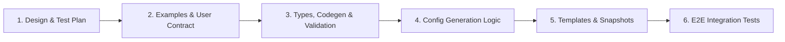

# Plan: Expand `JWTAuth` Policy to Include Claim Validation (#11174)

## Status: Draft (revision 2)

## Summary

**Goal:** Expand the `JWTAuth` policy (`spec.jwt`) in NGINX Ingress Controller (NIC) to support declarative JWT claim validation (`spec.jwt.authorization`).

The structure follows [NGINX Gateway Fabric (NGF) JWT Claim Validation](https://docs.nginx.com/nginx-gateway-fabric/traffic-security/jwt-claim-validation/#understanding-the-configuration): two-level `require`, `rules`, `claims`, `match`, `values`, `proxySetHeader`. Product direction is to follow NGF for nesting and AND/OR semantics.

NIC deviates from NGF in these places, each covering a requirement from [#6829](https://github.com/nginx/kubernetes-ingress/issues/6829) or a correctness issue:

| Deviation | Reason |
|---|---|
| `.` nested-claim delimiter (NGF uses `/`) | Consistent with NIC tiered rate limiting (`spec.rateLimit.condition.jwt.claim`). |
| `authorization.require` defaults to `All` (NGF: `Any`) | Fail-safe default for a security feature: a list of rules reads as "require these". |
| `match: Contains` | Array claims (`aud`, `realm_access.roles`) and space-delimited claims (`scope`) cannot be matched with `Exact`. |
| `match: Present` + `negate` | #6829 requires claim presence and negative matching. |
| `errorCode` (`401`/`403`, default `403`) | #6829: authorization failures must return `403` or a configurable code. |
| `Exact` is case-sensitive | `map` string matching is case-insensitive; JWT claim values are case-sensitive. |

**Dependency:** #6829's routing criteria ("a validated claim can be used in a route match condition") are delivered by [#11175](https://github.com/nginx/kubernetes-ingress/issues/11175). They are only met if #11175 validates the token before routing; see [Required: validate-then-route](#required-validate-then-route).

**References:**

- Issue: [#11174](https://github.com/nginx/kubernetes-ingress/issues/11174) (parent: [#6829](https://github.com/nginx/kubernetes-ingress/issues/6829))
- Companion: [#11175](https://github.com/nginx/kubernetes-ingress/issues/11175) match routing on `$jwt_` variables, plan [`jwt-variable-match-plan.md`](jwt-variable-match-plan.md) on branch `feat/jwt-variable-match`. See [Interaction with #11175](#interaction-with-11175-match-routing).
- User requests: [discussion #4417](https://github.com/nginx/kubernetes-ingress/discussions/4417), [discussion #10371](https://github.com/nginx/kubernetes-ingress/discussions/10371)
- NGF Documentation: [JWT Claim Validation](https://docs.nginx.com/nginx-gateway-fabric/traffic-security/jwt-claim-validation/#understanding-the-configuration)
- NGINX Plus: [`ngx_http_auth_jwt_module`](https://nginx.org/en/docs/http/ngx_http_auth_jwt_module.html), [`ngx_http_map_module`](https://nginx.org/en/docs/http/ngx_http_map_module.html)
- RFCs: [RFC 7519 §4.1.3](https://datatracker.ietf.org/doc/html/rfc7519#section-4.1.3) (`aud` is a string or array), [RFC 6749 §3.3](https://datatracker.ietf.org/doc/html/rfc6749#section-3.3) (`scope` is space-delimited, case-sensitive)

---

## API Design

Extend `JWTAuth` (`spec.jwt`) in `pkg/apis/configuration/v1/types.go` with an optional `authorization` field:

```yaml
apiVersion: k8s.nginx.org/v1
kind: Policy
metadata:
  name: orders-api-jwt
spec:
  jwt:
    realm: orders-api
    jwksURI: https://idp.example.com/realms/shop/protocol/openid-connect/certs
    keyCache: 1h
    authorization:
      errorCode: 403                    # Optional: 401 | 403 (default: 403)
      require: All                      # Optional: Any | All (default: All) - how rules combine
      rules:
        - require: All                  # Optional: Any | All (default: Any) - how claims in this rule combine
          claims:
            - name: aud                 # string or array (RFC 7519)
              match: Contains
              values: [orders-api]
            - name: scope               # space-delimited (RFC 6749)
              match: Contains
              values: ["orders:read", "orders:write"]
              proxySetHeader: X-Token-Scope
            - name: realm_access.roles  # nested claim, separated by '.'
              match: Contains
              values: [guest]
              negate: true              # must NOT contain guest
```

### Field Specification

| Field | Type | Required | Default | Validation / Constraints | Description |
|---|---|---|---|---|---|
| `jwt.authorization` | `*JWTAuthorization` | No | — | NGINX Plus only | Claim-based authorization rules, evaluated after JWT signature/expiry validation succeeds. |
| `authorization.errorCode` | `*int` | No | `403` | Enum: `401`, `403` | Status returned when claim validation fails. Authentication failures always return `401`. |
| `authorization.require` | `*JWTRequireType` | No | `"All"` | Enum: `Any`, `All` | Whether **any** rule or **all** rules must pass. Defaults to `All` (deviates from NGF). |
| `authorization.rules` | `[]JWTAuthorizationRule` | Yes | — | `MinItems: 1`, `MaxItems: 16` | Authorization rules. |
| `rules[].require` | `*JWTRequireType` | No | `"Any"` | Enum: `Any`, `All` | Whether **any** claim or **all** claims in the rule must pass. |
| `rules[].claims` | `[]JWTClaim` | Yes | — | `MinItems: 1`, `MaxItems: 32`; no duplicate `(name, match, negate)` tuples | Claim checks in the rule. The same `name` may appear more than once with a different `match`/`negate` (see Example 3). |
| `claims[].name` | `string` | Yes | — | Length `1..253`, pattern `^[a-zA-Z0-9_.-]+$`, non-empty `.`-separated segments | Claim name. Nested claims use `.` (e.g. `realm_access.roles`). |
| `claims[].match` | `*JWTClaimMatchType` | No | `"Exact"` | Enum: `Exact`, `Contains`, `Regex`, `Present` | See [Match semantics](#match-semantics). |
| `claims[].values` | `[]string` | Conditional | — | Required (`MinItems: 1`, `MaxItems: 64`) unless `match: Present`; forbidden for `Present`. No empty strings. | Expected values. A check passes if the claim matches **any** value. |
| `claims[].negate` | `bool` | No | `false` | — | Inverts the check. `match: Present, negate: true` means "claim must be absent". |
| `claims[].proxySetHeader` | `string` | No | — | Length `1..253`, pattern `^[-_A-Za-z0-9]+$`; unique within the policy; forbidden with `match: Present, negate: true` | Forwards the extracted claim value to the upstream. |

### Match semantics

| `match` | `negate: false` passes when… | `negate: true` passes when… |
|---|---|---|
| `Exact` | claim equals one of `values` (case-sensitive) | claim is present **and** equals none of `values` |
| `Contains` | claim, split on space or comma, contains one of `values` | claim is present **and** contains none of `values` |
| `Regex` | claim matches one of `values` (PCRE, case-sensitive) | claim is present **and** matches none of `values` |
| `Present` | claim is present and non-empty | claim is absent or empty |

**Invariant: a value check (`Exact`, `Contains`, `Regex`) never passes on a missing claim, whether negated or not.** Only `Present` with `negate: true` accepts a missing claim. A user who wants "not `guest`, or no role at all" states it explicitly (Example 3).

Notes:

- `auth_jwt_claim_set` joins array elements with commas, so `Contains` treats both `,` and space as separators. A scalar value containing a space or comma (e.g. `"Jane Doe"`) is also tokenised.
- An empty-string claim (`""`) and an empty array (`[]`) are treated as absent.

---

## Examples

Each example shows token outcomes and the generated config. In the config snippets, map names are shortened to `$authz_r<i>_c<j>`; see [Variable naming](#variable-naming) for the real names.

### Example 1: Keycloak API — arrays, scopes, negated role

The policy is the one in [API Design](#api-design).

| Token | Result | Why |
|---|---|---|
| `aud: ["orders-api","account"]`, `scope: "openid orders:read"`, `roles: ["customer"]` | 200 | All three claims pass |
| `aud: "account"` | 403 | `aud` does not contain `orders-api` |
| `scope: "openid profile"` | 403 | Neither scope present |
| `roles: ["customer","guest"]` | 403 | Negated `Contains` matched `guest` |
| no `realm_access` claim | 403 | Missing claim fails a value check (fail-closed) |
| expired token / bad signature | 401 | Authentication fails before claims are evaluated |

```nginx
# http context
auth_jwt_claim_set $jwt_default_shop_vs_aud                aud;
auth_jwt_claim_set $jwt_default_shop_vs_scope              scope;
auth_jwt_claim_set $jwt_default_shop_vs_realm_access_roles realm_access roles;

map $jwt_default_shop_vs_aud $authz_r0_c0 {
    ""                                            0;
    "~(^|[ ,])(orders-api)([ ,]|$)"               1;
    default                                       0;
}
map $jwt_default_shop_vs_scope $authz_r0_c1 {
    ""                                            0;
    "~(^|[ ,])(orders:read|orders:write)([ ,]|$)" 1;
    default                                       0;
}
map $jwt_default_shop_vs_realm_access_roles $authz_r0_c2 {
    ""                                            0;   # missing -> fail
    "~(^|[ ,])(guest)([ ,]|$)"                    0;   # negated
    default                                       1;
}
map $authz_r0_c0$authz_r0_c1$authz_r0_c2 $authz_r0 { "~^1+$" 1; default 0; }  # rule: All
map $authz_r0 $authz                                { "~^1+$" 1; default 0; }  # top:  All

# location
auth_jwt "orders-api";
auth_jwt_key_request /_jwks_uri_server_default/orders-api-jwt;
auth_jwt_require $authz error=403;
proxy_set_header X-Token-Scope $jwt_default_shop_vs_scope;
```

### Example 2: Multiple issuers (any-of-all), case-sensitive `Exact`, required-absent claim

```yaml
spec:
  jwt:
    realm: partner-api
    secret: partner-jwks
    authorization:
      require: Any                      # either rule is enough
      rules:
        - require: All                  # rule 0: first-party staff
          claims:
            - name: iss
              values: ["https://login.example.com"]
            - name: email
              match: Regex
              values: ['^[^@]+@example\.com$']
        - require: All                  # rule 1: partner services, never delegated
          claims:
            - name: iss
              values: ["https://partners.example.net"]
            - name: tenant.tier
              values: [Gold, Platinum]
            - name: act                 # RFC 8693 delegation claim
              match: Present
              negate: true              # must be absent
```

| Token | Result | Why |
|---|---|---|
| `iss: https://login.example.com`, `email: bob@example.com` | 200 | Rule 0 |
| `iss: https://LOGIN.example.com`, … | 403 | `Exact` is case-sensitive (a plain `map` string key would have allowed it) |
| `email: bob@EXAMPLE.com` | 403 | `~` regex is case-sensitive |
| `iss: https://partners.example.net`, `tenant.tier: Gold`, no `act` | 200 | Rule 1 |
| `tenant.tier: gold` | 403 | Case-sensitive |
| `tenant.tier: Gold`, `act: {"sub":"svc"}` | 403 | `act` present |
| `iss: https://partners.example.net`, no `tenant` | 403 | Missing claim fails a value check |

```nginx
map $jwt_default_partner_vs_iss $authz_r1_c0 {
    ""                                     0;
    "~^(https://partners\.example\.net)$"  1;   # QuoteMeta-escaped
    default                                0;
}
map $jwt_default_partner_vs_tenant_tier $authz_r1_c1 {
    ""                    0;
    "~^(Gold|Platinum)$"  1;
    default               0;
}
map $jwt_default_partner_vs_act $authz_r1_c2 {
    ""       1;                                  # Present + negate: absent passes
    default  0;
}
map $authz_r1_c0$authz_r1_c1$authz_r1_c2 $authz_r1 { "~^1+$" 1; default 0; }  # rule: All
map $authz_r0$authz_r1 $authz                       { "~1"    1; default 0; }  # top:  Any
```

`act` is a JSON object. What `auth_jwt_claim_set` returns for an object must be verified in Phase 4 (see [Verification gates](#verification-gates)).

### Example 3: Explicitly allowing a missing claim

```yaml
    authorization:                      # require defaults to All
      rules:
        - claims:
            - name: aud
              match: Contains
              values: [api]
        - require: Any                  # not guest, OR no role at all
          claims:
            - name: role
              values: [guest]
              negate: true
            - name: role
              match: Present
              negate: true
```

| `role` | Result |
|---|---|
| `admin` | 200 |
| `guest` | 403 |
| missing | 200 |

### Rejected at admission

```yaml
- {name: email, match: Present, values: [x]}                       # values forbidden with Present
- {name: debug, match: Present, negate: true, proxySetHeader: X-D} # nothing to forward
- {name: aud, values: [""]}                                        # empty value; use Present
- {name: aud}                                                      # values required unless Present
errorCode: 404                                                     # only 401 | 403
```

---

## NGINX Plus Configuration Design

Uses `ngx_http_auth_jwt_module` and `ngx_http_map_module`. NGINX Plus only.

### 1. Claim extraction (`http` context)

- `auth_jwt_claim_set $<claim_var> <segment> ...;` with `.` split into segments (`user_details.level` → `user_details level`).
- Reuse `generateAuthJwtClaimSetVariable` / `generateAuthJwtClaimSetClaim` (`internal/configs/policy.go`) so claims shared with `RateLimit` on the same parent are deduplicated by `removeDuplicateAuthJWTClaimSets` (`internal/configs/virtualserver.go`).
- Claim variables are shared by every feature that reads JWT claims on the same parent VirtualServer: rate limiting (`spec.rateLimit.condition.jwt`), this authorization feature, and `$jwt_custom_<path>` match routing ([#11175](jwt-variable-match-plan.md)). VirtualServerRoute policies and matches also use the parent VS (`internal/configs/virtualserver.go`, `policyOwnerDetails` with `parentType: "vs"`), so all three resolve to the same variable for the same claim.
- **Collision fix required:** `generateAuthJwtClaimSetVariable` maps `.` and `-` to `_`, so `a.b`, `a-b` and `a_b` produce the same variable. `removeDuplicateAuthJWTClaimSets` dedupes by variable and silently keeps the first claim path, so the second check reads the wrong claim. This is latent today for rate limiting. Once claims gate authorization it becomes an authorization bypass.
  - **Primary check (config generation):** in `removeDuplicateAuthJWTClaimSets`, when two entries share a `Variable` but differ in `Claim`, emit a warning and reject the resource whose claim was dropped. This is the only place that sees all three sources together. Validation cannot detect a Policy (`a_b`) colliding with a VirtualServer match (`$jwt_custom_a.b`).
  - **Early check (validation):** also reject collisions within a single Policy in Phase 2, so the common case fails at admission.

### 2. Claim maps (`http` context)

One map per claim check. All value matches compile to a **single case-sensitive regex** per claim (`~`), because `map` string keys are matched case-insensitively. `<alt>` is `values` escaped with `regexp.QuoteMeta` and joined with `|`.

| `match` | `negate: false` | `negate: true` |
|---|---|---|
| `Exact` | `"" 0;` `"~^(<alt>)$" 1;` `default 0;` | `"" 0;` `"~^(<alt>)$" 0;` `default 1;` |
| `Contains` | `"" 0;` `"~(^\|[ ,])(<alt>)([ ,]\|$)" 1;` `default 0;` | `"" 0;` `"~(^\|[ ,])(<alt>)([ ,]\|$)" 0;` `default 1;` |
| `Regex` | `"" 0;` `"~<p1>" 1;` … `default 0;` | `"" 0;` `"~<p1>" 0;` … `default 1;` |
| `Present` | `"" 0;` `default 1;` | `"" 1;` `default 0;` |

- `map` checks exact string keys before regexes, so the literal `""` key always wins. That ordering is what enforces the missing-claim invariant, and it closes a fail-open case where a `Regex` such as `.*` would match an empty claim.
- The regex key is `"~..."`, with the `~` **inside** the quotes. `~"..."` would make the quote part of the pattern.
- `Regex` values are emitted as written (not `QuoteMeta`'d), one key per value.
- `version2.Map` parameters are rendered raw (`nginx-plus.virtualserver.tmpl`: `{{ $p.Value }} {{ $p.Result }};`), so the generator owns all quoting. Precedent: `generateCORSOriginMap` in `internal/configs/policy.go`.

### 3. Rule and policy maps (`http` context)

- Rule map: source is the concatenation of the rule's claim-map variables; `"~^1+$" 1;` for `All`, `"~1" 1;` for `Any`, `default 0;`.
- Policy map: same, over rule-map variables, keyed on `authorization.require`.
- Always emit the full claim → rule → policy chain, even for a single rule. This keeps one code path and one snapshot shape. Rejected alternative: emitting multiple variables to `auth_jwt_require` (which already ANDs them) for the `All` case. That would produce less config but needs a second code path.
- **Invariant:** every claim map and rule map emits exactly one character (`0` or `1`). The `"~^1+$"` / `"~1"` evaluation depends on it.

### 4. Enforcement (`server` / `location` context)

- `auth_jwt_require $<policy_var> error=<errorCode>;` (`error=` is supported since nginx 1.21.7).
- Emit it in exactly the blocks where that policy's own `auth_jwt` is emitted:
  - `server` (spec-level policy);
  - proxied `location` (route/subroute-level policy);
  - the routing entry location (`InternalRedirectLocation`) of a route whose match conditions reference `$jwt_*` ([#11175](jwt-variable-match-plan.md)). Under the required [validate-then-route](#required-validate-then-route) design this is **where claims are checked before a route is chosen**. A failing token gets `401`/`errorCode` here and never reaches the routing decision.
  - For entry locations that still use `rewrite ... last` (routes whose matches don't reference `$jwt_*`, and `splits`), the access phase never runs, so `auth_jwt`/`auth_jwt_require` there would have no effect. Neither is emitted for those routes.
- **Single template definition:** move the JWT directive block (`auth_jwt`, `auth_jwt_key_file`, `auth_jwt_key_cache`, `auth_jwt_key_request`, `auth_jwt_require`) into one `{{ define }}` in `nginx-plus.virtualserver.tmpl`, and call it at all three sites. Today the block is copied at `server` and `location` level, and #11175 would add a third copy. One definition keeps the pairing in the template structure itself, not in reviewers' heads.
- `auth_jwt_require` is inherited and has **no `off` value**. Snapshot fixtures must prove it does not reach:
  - OIDC locations, which re-use `auth_jwt "" token=$session_jwt;`;
  - ACME-challenge locations (`auth_jwt off;`);
  - `/_jwks_uri_server_*` internal locations.

### 5. Claim header forwarding (`location` context)

- `{{ $proxyOrGRPC }}_set_header <proxySetHeader> $<claim_var>;` in every proxied location, for both route-level policies and server-level policies inherited by locations. Locations always emit their own `proxy_set_header`, which overrides server-level ones.
- Reject duplicate `proxySetHeader` names within a policy.
- **Route headers win.** If the location's `action.proxy.requestHeaders` sets a header with the same name (case-insensitive), skip the policy's header. [#11175](jwt-variable-match-plan.md) makes this likely, since `${jwt_claim_<name>}` becomes valid in `requestHeaders`. Reuse the existing check that already suppresses default `X-Forwarded-*` headers:

  ```gotemplate
  {{- $custom_headers := $l.ProxySetHeaders | headerListToCIMap }}
  ...
  {{- range $h := $jwt.ProxySetHeaders }}
  {{- if not ($custom_headers | hasCIKey $h.Name) }}
  {{ $proxyOrGRPC }}_set_header {{ $h.Name }} {{ $h.Value }};
  {{- end }}
  {{- end }}
  ```

  Here `$jwt` is `$l.JWTAuth`, falling back to `$s.JWTAuth`. Add a snapshot fixture where both set the same header.
- Document collisions with OIDC's `username` header.
- Under `rules[].require: Any`, a forwarded header carries the claim's value even when that particular check failed. Document this.

### Variable naming

A policy can be attached to several parents, and claim variables are per parent. So check maps must include the parent and the policy:

- Claim (shared, existing): `$jwt_<parentNs>_<parentName>_<parentType>_<claim>`
- Claim check: `$jwt_authz_<parentNs>_<parentName>_<parentType>_<policyNs>_<policyName>_r<i>_c<j>`
- Rule: `..._r<i>`
- Policy: `$jwt_authz_<parentNs>_<parentName>_<parentType>_<policyNs>_<policyName>`

All `-` become `_`. If the policy were left out, two routes with different JWT policies would collide. If the parent were left out, two VirtualServers sharing a policy would emit duplicate maps and fail `nginx -t`.

---

## Scope and Gaps vs #6829

| #6829 requirement | Status |
|---|---|
| Required claim validation on the existing JWT Policy | Covered |
| Claim presence / exact / negative / regex matching | Covered (`Present`, `Exact`, `negate`, `Regex`) |
| Multiple claim requirements; all must pass | Covered (`authorization.require` defaults to `All`) |
| Authorization failure returns 403 or configurable | Covered (`errorCode`) |
| Authentication failure returns 401 | Existing `auth_jwt` behaviour |
| Fail closed on key-service failure | Existing `auth_jwt` behaviour; E2E test added in Phase 5 |
| Invalid config rejected without replacing last valid config | Existing behaviour; validation added in Phase 2 |
| Logs/metrics distinguish authN / authZ / key retrieval | Partial: `401` vs `403` distinguishes authN from authZ in access logs. The rest is deferred. |
| Validated claims in VS/VSR match conditions | Deferred → [#11175](https://github.com/nginx/kubernetes-ingress/issues/11175), plan: [`jwt-variable-match-plan.md`](jwt-variable-match-plan.md) (branch `feat/jwt-variable-match`). **#6829 is only met if #11175 adopts [validate-then-route](#required-validate-then-route).** The current #11175 plan evaluates matches in the REWRITE phase, before `auth_jwt`. |
| Claims never trusted before JWT validation succeeds | Covered for authorization (claims are only read in the ACCESS phase, after `auth_jwt`). For routing, depends on #11175 adopting [validate-then-route](#required-validate-then-route). |
| JWT policy on `kind: Ingress` (prerequisite) | Deferred → [#10660](https://github.com/nginx/kubernetes-ingress/issues/10660). This plan changes `version2` (VirtualServer) only. |
| Only authenticated claims affect rate-limit counters | **Partial, via #11175.** On routes that match on `$jwt_*`, validate-then-route means `limit_req` in the target location only sees tokens that already passed `auth_jwt`. That is the two-hop workaround from [discussion #10371](https://github.com/nginx/kubernetes-ingress/discussions/10371), generated automatically. All other JWT-protected routes still need a new issue: `limit_req` runs in PREACCESS, before `auth_jwt` in the same location. |
| Claim names containing `.`, `/` or `:` (e.g. Auth0 `https://example.com/roles`) | **Documented limitation.** Not expressible with the `.` delimiter and name pattern. Future escape hatch: `nameSegments: [...]`. |

Also out of scope: NGINX OSS. `authorization` is rejected on OSS, and nothing from it may appear in OSS templates or OSS snapshots.

### Interaction with #11175 (match routing)

The two features are designed to be used together. Shared pieces:

| Concern | Owner | Notes |
|---|---|---|
| Claim-path syntax and validation | Shared `validateJWTClaimPath` (Phase 2) | Used by `claims[].name` and `$jwt_custom_<path>`. Without it, `user-details.level` would pass in a Policy but be rejected in a match condition. Rate limiting keeps its broader rule for now (follow-up issue). |
| `auth_jwt_claim_set` variables and dedup | `removeDuplicateAuthJWTClaimSets` | One variable per (parent VS, claim). Collision detection lives here ([§1](#1-claim-extraction-http-context)). |
| JWT directive block | Shared template `define` | Rendered at `server`, `location`, and the validate-then-route entry location ([§4](#4-enforcement-server--location-context)). |
| Order of validation and routing | #11175, required by this plan | [Validate-then-route](#required-validate-then-route). |
| Upstream claim headers | Route `requestHeaders` win over `proxySetHeader` | [§5](#5-claim-header-forwarding-location-context). |

**Matching semantics differ by design.** Routing conditions keep the semantics of every other VS condition (headers, cookies, arguments). Authorization is stricter. Both are documented side by side:

| | Routing condition (#11175) | Authorization (this plan) |
|---|---|---|
| Case | Case-insensitive (quoted `map` string, `generateValueForMatchesRouteMap`) | Case-sensitive (`~` regex) |
| Negation | `!value` prefix | `negate: true` |
| Array / space-delimited claims | Not supported: equality against the comma-joined value | `Contains` |
| Missing claim | Matches `""` / falls to default route | Value checks fail (fail-closed) |

Because authorization is always the stricter of the two, the difference cannot widen access. For example, routing `premium` to the premium upstream still requires the authorization check to accept the token.

#### Required: validate-then-route

#6829 requires that *"a validated claim can be used in a route match condition"* and that *"claims are never trusted before JWT validation succeeds"*. It lists *"routing based on unvalidated JWT data"* as out of scope.

**The current #11175 plan does not meet this.** Its entry location jumps with `rewrite ^ $vs_..._matches_N last;` (`nginx-plus.virtualserver.tmpl`, `InternalRedirectLocations`). That evaluates the match map, and therefore the `$jwt_*` claims, in the REWRITE phase. `auth_jwt` only runs later, in the ACCESS phase of the target location ([phase order](https://nginx.org/en/docs/dev/development_guide.html#http_phases)):

```text
SERVER_REWRITE → FIND_CONFIG → REWRITE → POST_REWRITE → PREACCESS → ACCESS → POST_ACCESS → PRECONTENT → CONTENT
                               rewrite                  limit_req    auth_jwt               try_files
```

| Step | Current #11175 | Required |
|---|---|---|
| `auth_jwt` + `auth_jwt_require` | target location, ACCESS | **entry location, ACCESS** |
| Match map evaluated, route chosen | entry location, REWRITE: **unverified** | entry location, PRECONTENT: **verified** |
| `limit_req` | target location, PREACCESS: unverified | target location, PREACCESS: verified |
| `auth_jwt` + `auth_jwt_require` (again) | — | target location, ACCESS (defence in depth) |

The outcome is safe either way. Every match target runs ACCESS before it can respond: `proxy`/`pass` targets proxy to the upstream, and `return`/`redirect` targets proxy to `nginx418Server` (`generateLocationForReturn`, `generateLocationForRedirect`). But the current order still:

- breaks the #6829 wording;
- depends on `$jwt_*` variables being populated before ACCESS. That is unverified for JWS, and not possible for JWE: claims of encrypted tokens are only available after decryption in ACCESS;
- lets forged tokens increment the target route's `limit_req` counters (discussion #10371).

**Required change in #11175:** when any match condition on a route references `$jwt_*`, the entry location validates first and routes in PRECONTENT using `try_files`. The last parameter of `try_files` is an internal redirect to a URI, which can contain variables, so the existing match map is reused unchanged:

```nginx
location /coffee {
    {{ template "jwtAuth" ... }}            # auth_jwt, key directives, auth_jwt_require ... error=<code>
    client_max_body_size 0;
    root /dev/null;                         # guarantees the probe path cannot exist
    try_files /nic-route $vs_default_cafe_matches_0;
}
```

Requirements on #11175 that this plan depends on:

| # | Requirement |
|---|---|
| R1 | Use `try_files` (PRECONTENT) instead of `rewrite ... last` (REWRITE) **only** for routes whose match conditions reference `$jwt_*`. All other `matches` and every `splits` route keep `rewrite`, so existing configs and snapshots do not change. One flag on `InternalRedirectLocation`. |
| R2 | The entry location renders the shared JWT block for route/subroute-level policies, including `auth_jwt_require`. Spec-level policies are inherited from `server`. |
| R3 | Reject (config-generation warning, resource invalid) a VS/VSR whose match conditions reference `$jwt_*` when no JWT policy applies to that route at spec or route level. Otherwise nothing ever validates the token. |
| R4 | Render the route's `errorPages` for `401` and for `errorCode` in the entry location, because authentication and authorization failures now happen there. |
| R5 | Keep `auth_jwt`/`auth_jwt_require` in the target locations as defence in depth. Cost: one extra signature verification per request (keys come from `auth_jwt_key_cache`, so no extra JWKS fetches). Revisit only if profiling shows it matters. |
| R6 | The `try_files` probe path must never exist. `root /dev/null;` makes `/dev/null/nic-route` fail with `ENOTDIR`. Cost: one `stat` per request. |

Rejected alternatives:

| Option | Why not |
|---|---|
| `proxy_pass http://$upstream_from_claim` | Only switches the upstream. Match actions can be `return`/`redirect` or carry different proxy settings. |
| A content-phase proxy to `nginx418Server` with `error_page 418 = $vs_..._matches_N;` (in-tree pattern) | Works, but adds a proxied hop over a Unix socket per request. `try_files` costs a `stat`. |
| `auth_request` / `js_set` verifying the JWT | `auth_request` also runs in ACCESS, after `rewrite`. `js_set` reimplements `auth_jwt`. |

Until #11175 adopts this, the security guidance (Phase 6) must state that routing on `$jwt_*` uses unverified claims, and that authentication and authorization are still enforced before any response.

---

## Verification gates

These must be confirmed against a running NGINX Plus in Phase 4 before the design is final:

1. `auth_jwt_claim_set` output for a missing claim, `""`, `[]`, `null`, `true`/`false`, numbers, and JSON objects (`act` in Example 2).
2. `nginx -t` accepts the generated `"~..."` keys, including `QuoteMeta` output.
3. Backslash handling: inside a quoted nginx string `\\` collapses to `\`, which breaks `QuoteMeta` output for a value containing `\`. Either forbid `\` in `Exact`/`Contains` values or double-escape it.
4. `auth_jwt_require` set at server level does not affect OIDC, ACME or JWKS locations.
5. `error=403` is returned on claim failure and `401` on signature failure.
6. **Joint tests with #11175 (validate-then-route):** a route-level JWT Policy with `authorization`, plus a `$jwt_custom_<path>` match condition on the same route.
   - A token that would select the match route but fails a claim check gets `403` from the **entry** location. The match map is never evaluated (debug log), and no upstream receives anything. Repeat with a `return` and a `redirect` match target.
   - A forged/invalid signature gets `401` from the entry location.
   - `try_files` with a variable fallback reaches the regex-matched internal locations, and the query string is preserved as it is with `rewrite ... last`.
   - `$jwt_*` and `auth_jwt_claim_set` variables are populated in PRECONTENT for JWS **and** JWE tokens.
   - Route `errorPages` for `401`/`403` are served from the entry location.
   - **Discussion #10371 regression:** `limit_req` keyed on a claim in the target location does not count requests rejected by `auth_jwt` in the entry location.

---

## Implementation Phases

### Phase 1: Examples & User Contract

- Add `examples/custom-resources/jwt-claim-validation/` containing Examples 1–3: Policy, VirtualServer, JWK Secret, webapp, and a README with token outcomes.
- Use `Contains` for `aud`/`scope` in every example. Do not show `Exact` on array claims.

### Phase 2: CRD Types, Codegen & Validation

1. **`pkg/apis/configuration/v1/types.go`**
   - Add `Authorization *JWTAuthorization` (`json:"authorization,omitempty"`) to `JWTAuth`.
   - Types: `JWTRequireType` (`Any`, `All`), `JWTClaimMatchType` (`Exact`, `Contains`, `Regex`, `Present`), `JWTAuthorization` (`ErrorCode *int`, `Require *JWTRequireType`, `Rules`), `JWTAuthorizationRule`, `JWTClaim` (`Name`, `Match`, `Values`, `Negate`, `ProxySetHeader`).
   - Kubebuilder enum/length/item markers, plus CEL on `JWTClaim`:
     - `values` required unless `match == 'Present'`, forbidden when it is;
     - `proxySetHeader` forbidden when `match == 'Present' && negate`.
2. **Codegen:** `make update-codegen`, then `make update-crds`. Commit `config/crd/bases`, `pkg/**`, and check `deploy/crds*.yaml` and `docs/crd/` by hand (CI does not diff them). No `internal/telemetry` change is expected (policies are counted by type). Confirm with `make telemetry-schema`.
3. **`pkg/apis/configuration/validation/policy.go`:** in `validateJWT`, call `validateJWTAuthorization` when `jwt.Authorization != nil`:
   - `errorCode` ∈ {401, 403}; `require` ∈ {Any, All}; rule/claim/value counts.
   - `name`: validated by a new shared `validateJWTClaimPath(path string, fieldPath *field.Path) field.ErrorList`. Rule: split on `.`; every segment must be non-empty, match `[a-zA-Z0-9_-]+`, pass `validation2.ValidateDirectiveToken`, and contain no `$`. `-` is allowed, matching existing rate-limit behaviour; the `-`/`_` variable collision is handled at generation time (Configuration Design §1).
     - [#11175](jwt-variable-match-plan.md) should validate `$jwt_custom_<path>` with the same helper, instead of `isValidSpecialHeaderLikeVariable` (which rejects `-`).
     - **Rate limiting is not switched in this PR.** `validateRateLimitJWTCondition` accepts any `ValidateDirectiveToken` segment (`internal/validation/nginx.go`), which includes `:`, `/` and `@`. Those characters end up in the generated `$jwt_..._<claim>` variable name, which is likely not a valid NGINX variable. Moving rate limiting to the shared rule is stricter and therefore potentially breaking. Open a follow-up issue to confirm whether such claims ever produced a working config, and to adopt the shared rule.
     - Until then, a rate-limit claim that only rate limiting accepts cannot be reused in authorization or routing. Document this.
   - Claim-variable collision check within the policy (early check; the cross-resource check is in Phase 3).
   - `values`: present/absent per `match`; no empty strings; `containsDangerousChars`; `Regex` compiles; backslash rule (Verification gate 3).
   - No duplicate `(name, match, negate)` within a rule; no duplicate `proxySetHeader` within the policy.
   - Mirror the CEL rules for clusters without CEL enforcement.
4. **Tests:** table-driven cases in `pkg/apis/configuration/validation/policy_test.go` covering every rule above.

### Phase 3: Config Generation

1. **`internal/configs/version2/http.go`:** extend `JWTAuth` with `RequireVariable string`, `RequireErrorCode int`, `ProxySetHeaders []Header`.
2. **`internal/configs/policy.go`:** in `addJWTAuthConfig`, generate the claim sets, claim/rule/policy maps (per the [Configuration Design](#nginx-plus-configuration-design) table and [Variable naming](#variable-naming)), the require variable and the headers. Thread `policyOwnerDetails` through, as `RateLimit` does.
3. **`internal/configs/virtualserver.go`:**
   - Append JWT claim sets and maps to `authJWTClaimSets` / `maps` for spec, route and subroute policies.
   - In `removeDuplicateAuthJWTClaimSets`, detect entries with the same `Variable` and a different `Claim`, and return a warning for the resource whose claim was dropped (Configuration Design §1).
   - **Merge note:** [#11175](jwt-variable-match-plan.md) appends `cfg.AuthJWTClaimSets` at the same three call sites. Whichever PR lands second rebases.
4. **Tests:** `internal/configs/policy_test.go`: a table covering the 4 match types × `negate`, each against a missing, empty, matching and non-matching claim value; `require` `Any`/`All` at both levels; naming with a policy shared by two parents; collision detection within a policy. `internal/configs/virtualserver_test.go`: spec, route and VSR wiring; collisions across resources (Policy claim `a_b` vs rate-limit `a.b`, and vs `$jwt_custom_a.b` once #11175 lands).

### Phase 4: Templates & Snapshots

1. **`internal/configs/version2/nginx-plus.virtualserver.tmpl`:**
   - Extract the existing `server`- and `location`-level `auth_jwt` blocks into one `{{ define "jwtAuth" }}`, and add `auth_jwt_require {{ .RequireVariable }} error={{ .RequireErrorCode }};` to it. Call it from `$s.JWTAuth` and `$l.JWTAuth`. #11175 calls the same define from `InternalRedirectLocations` for `$jwt_*` match routes, alongside `try_files` (Configuration Design §4, [validate-then-route](#required-validate-then-route)).
   - `{{ $proxyOrGRPC }}_set_header` for `ProxySetHeaders` in proxied locations, from `$l.JWTAuth` or the inherited `$s.JWTAuth`, skipping names already set by `requestHeaders` (`hasCIKey`).
   - The OSS template is not modified.
2. **Snapshot fixtures** (`internal/configs/version2/templates_test.go`; `internal/configs` has no snapshot tests, so its coverage stays in the Phase 3 unit tests):
   - every match type × `negate`, both `require` values at both levels, `errorCode` 401 and 403, `proxySetHeader` for HTTP and gRPC;
   - negative fixtures: server-level JWT authorization combined with an OIDC location, an ACME-challenge location, and a JWKS location;
   - `proxySetHeader` and `requestHeaders` setting the same header name (the policy header must be absent from output);
   - once #11175 lands: route-level authorization with `$jwt_*` matches, showing the JWT block (including `auth_jwt_require`) and `try_files` in the entry location. Also a route with non-JWT `matches` showing the entry location unchanged (`rewrite ... last`, no JWT block).
   - Run `make test-update-snaps`. An empty snapshot diff means the fixture is not exercising the new branch.
3. Run the [Verification gates](#verification-gates) against NGINX Plus.

### Phase 5: E2E Integration Tests

Extend `tests/suite/test_jwt_policies.py` and `tests/suite/test_jwt_policies_vsr.py` (manifests in `tests/data/jwt-policy/policies/`):

- missing / invalid / expired JWT → 401;
- required claim missing → 403; claim allowed → 200; claim rejected → 403;
- `Contains` on an array claim and on a space-delimited claim;
- `Present` and `Present` + `negate`; negated value with a matching, a non-matching and a missing claim;
- `Exact` case-sensitivity;
- `require` `Any`/`All` at both levels;
- `errorCode: 401` vs `403`;
- `proxySetHeader` value received by the upstream;
- JWKS endpoint unavailable with no cached keys → request rejected.

Register any new pytest markers in `pyproject.toml`.

### Phase 6: Documentation

Per #11174's acceptance criteria and #6829's documentation requirements, in `nginx/documentation`:

- Configuration guide: Examples 1–3.
- Reference: fields, match semantics table, defaults, status codes.
- Security guidance: fail-closed behaviour; the missing-claim invariant; `Any` is permissive; empty `""`/`[]` claims are treated as absent; claim values are not logged by default; `proxySetHeader` under `Any`; match routing on `$jwt_*` (#11175) only evaluates claims after `auth_jwt` and `auth_jwt_require` succeed ([validate-then-route](#required-validate-then-route)). If #11175 ships without it, state instead that routing uses unverified claims but every response is still gated by authentication and authorization.
- Routing vs authorization matching semantics: the side-by-side table from [Interaction with #11175](#interaction-with-11175-match-routing).
- Differences from NGF: `.` delimiter, `require: All` default, `Contains`, `Present`/`negate`, `errorCode`, case-sensitive `Exact`.
- Limitation: claim names containing `.`, `/` or `:`.

### Cross-plan and cross-project actions

- **#11175 (match routing):** agree requirements R1–R6 of [validate-then-route](#required-validate-then-route), plus the shared `validateJWTClaimPath`, collision detection in `removeDuplicateAuthJWTClaimSets`, the shared `jwtAuth` template define, and `requestHeaders` winning over `proxySetHeader`. #6829's routing criteria depend on R1–R3.
- **Rate limiting:** open a follow-up issue to (a) adopt `validateJWTClaimPath`, which may be breaking (see Phase 2), and (b) make claim-keyed rate limiting count only validated tokens on routes without `$jwt_*` matches (discussion #10371).
- **NGF:** open an issue on `nginx/nginx-gateway-fabric` proposing the same names (`Contains`, `Present`, `negate`, `errorCode`) and reporting that `map` string keys are matched case-insensitively. This keeps the two APIs from diverging further.

---

## PR / Commit Stack Structure



| Order | Scope | Purpose for Reviewers | Files Included |
| :---: | --- | --- | --- |
| **1** | **Design & Test Plan** | Agree the API (`jwt.authorization`, match types, `negate`, `errorCode`, defaults), the NGINX directive mapping, NGF deviations and the gaps vs #6829. | • [`docs/developer/jwt-claim-validation-plan.md`](jwt-claim-validation-plan.md) |
| **2** | **Examples & User Contract** | Show the end-user experience (Examples 1–3) before implementation. | • `examples/custom-resources/jwt-claim-validation/` |
| **3** | **Types, Codegen & Validation** | CRD types, CEL, regenerated manifests/docs, Go validation and tests. | • [`pkg/apis/configuration/v1/types.go`](../../pkg/apis/configuration/v1/types.go)<br>• [`pkg/apis/configuration/v1/zz_generated.deepcopy.go`](../../pkg/apis/configuration/v1/zz_generated.deepcopy.go)<br>• `pkg/client/**`<br>• [`config/crd/bases/k8s.nginx.org_policies.yaml`](../../config/crd/bases/k8s.nginx.org_policies.yaml)<br>• [`deploy/crds.yaml`](../../deploy/crds.yaml) & [`deploy/crds-nap-dos.yaml`](../../deploy/crds-nap-dos.yaml)<br>• [`docs/crd/k8s.nginx.org_policies.md`](../crd/k8s.nginx.org_policies.md)<br>• [`pkg/apis/configuration/validation/policy.go`](../../pkg/apis/configuration/validation/policy.go)<br>• [`pkg/apis/configuration/validation/policy_test.go`](../../pkg/apis/configuration/validation/policy_test.go) |
| **4** | **Config Generation Logic** | Claim extraction, map chain, variable naming, collision handling, header propagation, unit tests. | • [`internal/configs/version2/http.go`](../../internal/configs/version2/http.go)<br>• [`internal/configs/policy.go`](../../internal/configs/policy.go)<br>• [`internal/configs/policy_test.go`](../../internal/configs/policy_test.go)<br>• [`internal/configs/virtualserver.go`](../../internal/configs/virtualserver.go)<br>• [`internal/configs/virtualserver_test.go`](../../internal/configs/virtualserver_test.go) |
| **5** | **Template Rendering & Snapshots** | `auth_jwt_require ... error=`, header forwarding, negative-scope fixtures, verification gates. | • [`internal/configs/version2/nginx-plus.virtualserver.tmpl`](../../internal/configs/version2/nginx-plus.virtualserver.tmpl)<br>• [`internal/configs/version2/templates_test.go`](../../internal/configs/version2/templates_test.go)<br>• `internal/configs/version2/__snapshots__/` |
| **6** | **End-to-End Tests** | Runtime behaviour per Phase 5. | • [`tests/suite/test_jwt_policies.py`](../../tests/suite/test_jwt_policies.py)<br>• [`tests/suite/test_jwt_policies_vsr.py`](../../tests/suite/test_jwt_policies_vsr.py)<br>• [`tests/data/jwt-policy/policies/`](../../tests/data/jwt-policy/policies/) |
