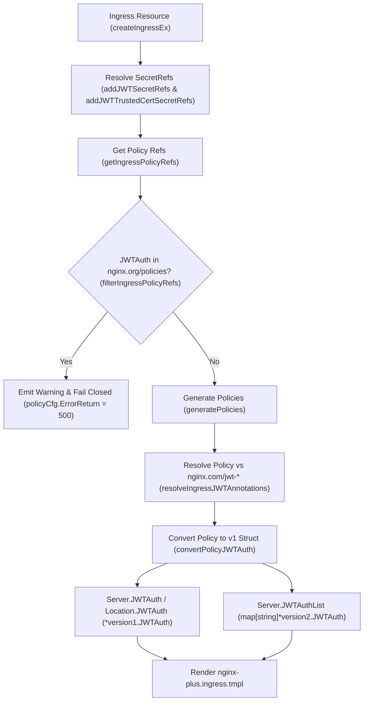
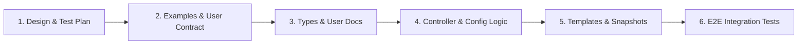

# High-Level Design & Implementation Plan: JWT Policy on Ingress

> Status: In Review
> Related work: [#10463](https://github.com/nginx/kubernetes-ingress/issues/10463)

## Overview

NGINX Ingress Controller (NIC) supports JWT authentication on `VirtualServer` and `VirtualServerRoute` resources via the `Policy` CRD (`spec.jwt`), while `networking.k8s.io/v1` `Ingress` resources previously only supported JWT authentication via `nginx.com/jwt-*` annotations (which only support local Kubernetes Secrets and do not support remote `jwksURI`, key caching, or SNI/TLS verification settings).

This design enables attaching a JWT `Policy` resource to standard and mergeable `Ingress` resources via the `nginx.com/policies` annotation, aligning JWT Policy behavior on Ingress with existing NGINX Plus policies (`WAF` and `OIDCNative`).

---

## Goals

- Support `Policy` resources with `spec.jwt` (both `secret` and `jwksURI` modes) on standard and mergeable (`master`/`minion`) `Ingress` resources.
- Require the NGINX Plus annotation `nginx.com/policies` for JWT policies on Ingress, matching `WAF` and `OIDCNative`.
- Fail closed (`return 500;`) when a JWT `Policy` is referenced via `nginx.org/policies`, matching `WAF` and `OIDCNative`.
- Define clear, deterministic precedence rules when multiple policies or `nginx.com/jwt-*` annotations are present.
- Extend `version1.JWTAuth` to render both `Policy`-based and `nginx.com/jwt-*` annotation-based JWT configurations through a single template block per scope (`server`, HTTP `location`, and gRPC `location`).
- Preserve full compatibility with `nginx.com/jwt-*` Ingress annotations.

---

## User Contract

### 1. Referencing a JWT Policy on Ingress

Because JWT authentication is an NGINX Plus feature, a JWT `Policy` on an `Ingress` resource must be referenced via `nginx.com/policies`:

```yaml
apiVersion: networking.k8s.io/v1
kind: Ingress
metadata:
  name: webapp-ingress
  annotations:
    nginx.com/policies: "jwt-policy"
spec:
  ingressClassName: nginx
  rules:
  - host: webapp.example.com
    http:
      paths:
      - path: /
        pathType: Prefix
        backend:
          service:
            name: webapp-svc
            port:
              number: 80
```

### 2. Annotation & Policy Precedence Rules

| Scenario | Behavior | Warning / Event | Status / Reload Impact |
| --- | --- | --- | --- |
| JWT Policy referenced via `nginx.com/policies` on NGINX Plus | Applied (`JWTAuth` rendered at `server` or `location` context) | None | Normal traffic with JWT validation |
| JWT Policy referenced via `nginx.org/policies` | Rejected by `filterIngressPolicyRefs` (`annotationPolicyError = true`), same as `WAF` and `OIDCNative` | Warning: `JWTAuth policy <ns>/<name> is not supported in annotation nginx.org/policies; use nginx.com/policies` | Fails closed: renders `return 500;` on the affected server/locations (`policyCfg.ErrorReturn = &version2.Return{Code: 500}`) |
| Both `JWT` Policy (`nginx.com/policies`) and `nginx.com/jwt-*` annotations on the **same** Ingress resource | `JWT` Policy takes precedence; `nginx.com/jwt-*` annotations on that resource are ignored | Warning: `JWT cannot be configured through both Policy and JWT annotations on the same Ingress; annotations <list> will be ignored because the Policy configuration takes precedence` | `JWT` Policy is rendered; `nginx.com/jwt-*` `cfgParams` fields are cleared |
| Multiple `JWT` Policies listed in `nginx.com/policies` on the same Ingress | First `JWT` Policy in the annotation list wins; subsequent `JWT` Policies are ignored | Warning: `Multiple jwt policies on the same context are not valid. JWT policy <ns>/<name> will be ignored` | First `JWT` Policy is rendered |
| Mergeable Ingress: `master` has `JWT` Policy or `nginx.com/jwt-*`, and `minion` has `JWT` Policy or `nginx.com/jwt-*` | `minion` overrides `master` for its `location` block | None | `server` block has `master` config; `minion` `location` block has `minion` config |
| Referenced `JWT` Policy is missing, fails CRD validation, or references an invalid/missing Secret | Treated as an invalid policy (`policyCfg.ErrorReturn = &version2.Return{Code: 500}`) | Warning event on Ingress | Fails closed: affected server/locations render `return 500;` |

---

## Architecture & Data Flow



### Component Breakdown

#### 1. Controller Secret Reference Resolution ([`internal/k8s/controller.go`](../../internal/k8s/controller.go))
In `createIngressEx`:
- Calls `lbc.addJWTSecretRefs(ingEx.SecretRefs, policies)` so any Secret referenced by `spec.jwt.secret` is validated, materialized to disk, and tracked in `ingEx.SecretRefs`.
- Calls `lbc.addJWTTrustedCertSecretRefs(ingEx.SecretRefs, policies)` so any CA Secret referenced by `spec.jwt.jwksURI.trustedCertSecret` is validated, materialized, and tracked in `ingEx.SecretRefs`.

#### 2. Policy Generation ([`internal/configs/policy.go`](../../internal/configs/policy.go))
- Enables `pol.Spec.JWTAuth` in `generatePolicies` for `specContext` and `minionContext` on Ingress (`ownerDetails.parentType == "ing"`).
- Populates `policyCfg.JWTAuth.Auth` (`*version2.JWTAuth`) and `policyCfg.JWTAuth.List` (`map[string]*version2.JWTAuth`, keyed by `<namespace>/<name>`) so `jwksURI`-backed policies generate deduplicated internal subrequest locations (`/_jwks_uri_server_<key>`).

#### 3. Ingress Annotation Resolution & Precedence ([`internal/configs/ingress.go`](../../internal/configs/ingress.go))
- **`ingressPoliciesRequiringPlusAnnotation`**: Adds `"JWTAuth"` alongside `"WAF"` and `"OIDCNative"`. If a user references a `JWTAuth` policy in `nginx.org/policies`, `filterIngressPolicyRefs` emits a warning and returns `annotationPolicyError = true`, causing `generateNginxCfg` to set `policyCfg.ErrorReturn = &version2.Return{Code: 500}` (fail closed).
- **`resolveIngressJWTAnnotations`**: Mirrors `resolveIngressAppProtectResources`. When an Ingress (standard, master, or minion) has both a valid `JWTAuth` policy in `nginx.com/policies` and `nginx.com/jwt-*` annotations:
  1. Emits a warning stating that the Policy configuration takes precedence.
  2. Clears `cfgParams.JWTKey`, `cfgParams.JWTRealm`, `cfgParams.JWTToken`, and `cfgParams.JWTLoginURL` so the `nginx.com/jwt-*` annotations are not applied.
- **`convertPolicyJWTAuth`**:
  Maps `*version2.JWTAuth` onto `*version1.JWTAuth`:
  - `Key`: `jwt.Secret` (JWK file path for `auth_jwt_key_file`)
  - `JWKSUriKey`: `jwt.Key` (policy `<namespace>/<name>` key for `auth_jwt_key_request /_jwks_uri_server_<key>`)
  - `JwksURI`: `jwt.JwksURI`
  - `KeyCache`: `jwt.KeyCache`
  - `Realm`: `jwt.Realm`
  - `Token`: `jwt.Token`

#### 4. Template Structs ([`internal/configs/version1/config.go`](../../internal/configs/version1/config.go))
- Extends `version1.JWTAuth` with `JWKSUriKey string`, `JwksURI version2.JwksURI`, and `KeyCache string` alongside the existing `Key`, `Realm`, `Token`, and `RedirectLocationName` fields:

```go
type JWTAuth struct {
	Key                  string
	JWKSUriKey           string
	JwksURI              version2.JwksURI
	KeyCache             string
	Realm                string
	Token                string
	RedirectLocationName string
}
```

- Adds `JWTAuthList map[string]*version2.JWTAuth` to `version1.Server` (merged across master and minions for mergeable Ingresses).

#### 5. NGINX Plus Template Rendering ([`internal/configs/version1/nginx-plus.ingress.tmpl`](../../internal/configs/version1/nginx-plus.ingress.tmpl))
- **Server-level JWKS subrequest locations**:
  Iterates over `$server.JWTAuthList` and renders `location = /_jwks_uri_server_{{.Key}}` for any policy using `jwksURI`, including `proxy_ssl_server_name`, `proxy_ssl_name`, `proxy_ssl_verify`, `proxy_ssl_trusted_certificate`, `proxy_ssl_verify_depth`, and `app_protect_enable off;` when App Protect is loaded.
- **Server, gRPC Location, and HTTP Location blocks**:
  Uses a single `{{with $jwt := $server.JWTAuth}}` / `{{- with $jwt := $location.JWTAuth}}` block:
  - When `$jwt.JwksURI.JwksHost` is non-empty: renders `auth_jwt_key_cache {{$jwt.KeyCache}};` (if set) and `auth_jwt_key_request /_jwks_uri_server_{{$jwt.JWKSUriKey}};`.
  - Otherwise: renders `auth_jwt_key_file {{$jwt.Key}};`.
  - Renders `auth_jwt "{{.Realm}}"{{if $jwt.Token}} token={{$jwt.Token}}{{end}};` and optional `error_page 401 {{$jwt.RedirectLocationName}};`.

---

## Files Modified / Added

| File | Change Summary |
| --- | --- |
| [`internal/k8s/controller.go`](../../internal/k8s/controller.go) | Resolve JWT Secret and TrustedCert Secret refs in `createIngressEx` |
| [`internal/configs/policy.go`](../../internal/configs/policy.go) | Allow `JWTAuth` policy on Ingress (`parentType == "ing"`) and populate `JWTAuth.List` |
| [`internal/configs/ingress.go`](../../internal/configs/ingress.go) | Add `"JWTAuth"` to `ingressPoliciesRequiringPlusAnnotation`, add `resolveIngressJWTAnnotations` and `convertPolicyJWTAuth`, wire `JWTAuth` and `JWTAuthList` on `Server` and `Location` |
| [`internal/configs/version1/config.go`](../../internal/configs/version1/config.go) | Extend `version1.JWTAuth` with `JWKSUriKey`, `JwksURI`, `KeyCache`; add `JWTAuthList map[string]*version2.JWTAuth` to `Server` |
| [`internal/configs/version1/nginx-plus.ingress.tmpl`](../../internal/configs/version1/nginx-plus.ingress.tmpl) | Render `JWTAuthList` subrequest locations and `JwksURI`/`KeyCache` branches in `JWTAuth` blocks at server, HTTP location, and gRPC location levels |
| [`internal/configs/policy_test.go`](../../internal/configs/policy_test.go) | Unit tests for `generatePolicies` with `JWTAuth` on Ingress |
| [`internal/configs/ingress_test.go`](../../internal/configs/ingress_test.go) | Unit tests for standard/mergeable Ingress JWT policies, `nginx.org/policies` rejection (`500`), and `JWT` policy vs `nginx.com/jwt-*` precedence |
| [`internal/configs/version1/template_test.go`](../../internal/configs/version1/template_test.go) | Template unit + snapshot test (`TestExecuteTemplatesForIngressWithJWTPolicyJWKS`) |
| [`examples/ingress-resources/jwt-secret-policy/`](../../examples/ingress-resources/jwt-secret-policy/) | Complete runnable example (`README.md`, `ingress.yaml`, `jwt.yaml`, `webapp.yaml`, `hack/secrets.json`) |
| [`tests/suite/test_jwt_policies_ingress.py`](../../tests/suite/test_jwt_policies_ingress.py) & [`tests/data/jwt-policy/ingress/`](../../tests/data/jwt-policy/ingress/) | End-to-end pytest suite and test manifests covering standard, mergeable master/minion, invalid policy/secret, and multi-policy override scenarios |

---

## PR / Commit Stack Structure

To keep reviews focused and incremental, the change can be structured as a 6-part commit / PR stack:



| Order | Scope | Purpose for Reviewers | Files Included |
| :---: | --- | --- | --- |
| **1** | **Design & Test Plan** | Align on architecture, annotation precedence, fail-closed (`500`) behavior, and manual verification plan before reviewing code. | • [`docs/developer/jwt-policy-on-ingress.md`](jwt-policy-on-ingress.md)<br>• [`docs/developer/README.md`](README.md) |
| **2** | **Examples** | Demonstrate the end-user UX (`nginx.com/policies` on `Ingress` + `Policy` CRD + JWK `Secret`) concretely. | • [`examples/ingress-resources/jwt-secret-policy/README.md`](../../examples/ingress-resources/jwt-secret-policy/README.md)<br>• [`examples/ingress-resources/jwt-secret-policy/ingress.yaml`](../../examples/ingress-resources/jwt-secret-policy/ingress.yaml)<br>• [`examples/ingress-resources/jwt-secret-policy/jwt.yaml`](../../examples/ingress-resources/jwt-secret-policy/jwt.yaml)<br>• [`examples/ingress-resources/jwt-secret-policy/webapp.yaml`](../../examples/ingress-resources/jwt-secret-policy/webapp.yaml)<br>• [`hack/secrets.json`](../../hack/secrets.json) & [`.gitignore`](../../.gitignore) |
| **3** | **Types & Documentation** | Review internal template struct extensions (`version1.JWTAuth`, `Server.JWTAuthList`) and inline documentation (`Policy` CRD / `Ingress` annotation docs). | • [`internal/configs/version1/config.go`](../../internal/configs/version1/config.go) |
| **4** | **Controller & Configurator Logic** | Review secret reference tracking (`createIngressEx`), policy generation (`parentType == "ing"`), `nginx.org/policies` fail-closed rejection, `nginx.com/jwt-*` precedence, and unit tests. | • [`internal/k8s/controller.go`](../../internal/k8s/controller.go)<br>• [`internal/configs/policy.go`](../../internal/configs/policy.go)<br>• [`internal/configs/policy_test.go`](../../internal/configs/policy_test.go)<br>• [`internal/configs/ingress.go`](../../internal/configs/ingress.go)<br>• [`internal/configs/ingress_test.go`](../../internal/configs/ingress_test.go) |
| **5** | **Template Rendering & Snapshots** | Review NGINX Plus Ingress template changes (`/_jwks_uri_server_*` subrequest locations, `auth_jwt_key_cache`, `auth_jwt_key_request`) and golden snapshot output. | • [`internal/configs/version1/nginx-plus.ingress.tmpl`](../../internal/configs/version1/nginx-plus.ingress.tmpl)<br>• [`internal/configs/version1/template_test.go`](../../internal/configs/version1/template_test.go)<br>• [`internal/configs/version1/__snapshots__/template_test.snap`](../../internal/configs/version1/__snapshots__/template_test.snap) |
| **6** | **End-to-End Tests** | Verify full runtime behavior in pytest across standard Ingress, mergeable master/minion Ingress, invalid policy/secret fail-closed `500`, and multi-policy precedence. | • [`tests/suite/test_jwt_policies_ingress.py`](../../tests/suite/test_jwt_policies_ingress.py)<br>• [`tests/data/jwt-policy/ingress/standard-ingress.yaml`](../../tests/data/jwt-policy/ingress/standard-ingress.yaml)<br>• [`tests/data/jwt-policy/ingress/mergeable-ingress.yaml`](../../tests/data/jwt-policy/ingress/mergeable-ingress.yaml) |

---

## Manual Test Plan (Happy, Error & Upgrade Paths)

### 1. Happy Paths

#### Test 1.1: Standard Ingress with `spec.jwt.secret` via `nginx.com/policies`
1. **Apply JWK Secret, Policy, and Ingress**:
   ```bash
   kubectl apply -f examples/ingress-resources/jwt-secret-policy/webapp.yaml
   kubectl apply -f examples/ingress-resources/jwt-secret-policy/jwk-secret.yaml
   kubectl apply -f examples/ingress-resources/jwt-secret-policy/jwt.yaml
   kubectl apply -f examples/ingress-resources/jwt-secret-policy/ingress.yaml
   ```
2. **Verify Policy status is `Valid`**:
   ```bash
   kubectl get policy jwt-policy -o yaml
   # Expect: status.state: Valid, status.reason: AddedOrUpdated
   ```
3. **Verify rendered NGINX config**:
   ```bash
   kubectl exec -n nginx-ingress "$IC_POD" -- cat /etc/nginx/conf.d/default-jwt-ingress.conf
   # Expect inside server block:
   #   auth_jwt_key_file /etc/nginx/secrets/default-jwk-secret;
   #   auth_jwt "MyProductAPI" token=$http_token;
   ```
4. **Verify runtime behavior**:
   - **No token -> HTTP 401**:
     ```bash
     curl -i --resolve webapp.example.com:$IC_HTTP_PORT:$IC_IP http://webapp.example.com:$IC_HTTP_PORT/
     # Expect: HTTP/1.1 401 Unauthorized, WWW-Authenticate: Bearer realm="MyProductAPI"
     ```
   - **Invalid token -> HTTP 401**:
     ```bash
     curl -i --resolve webapp.example.com:$IC_HTTP_PORT:$IC_IP http://webapp.example.com:$IC_HTTP_PORT/ -H "token: invalid.jwt.token"
     # Expect: HTTP/1.1 401 Unauthorized
     ```
   - **Valid token -> HTTP 200**:
     ```bash
     curl -i --resolve webapp.example.com:$IC_HTTP_PORT:$IC_IP http://webapp.example.com:$IC_HTTP_PORT/ -H "token: $TOKEN"
     # Expect: HTTP/1.1 200 OK (Server name: webapp-...)
     ```

#### Test 1.2: Standard Ingress with `spec.jwt.jwksURI`, `keyCache`, and `trustedCertSecret`
1. **Apply a CA Secret (`nginx.org/ca`) and a `jwksURI` Policy referencing `trustedCertSecret`**:
   ```bash
   kubectl apply -f - <<'EOF'
   apiVersion: v1
   kind: Secret
   metadata:
     name: jwks-ca-secret
   type: nginx.org/ca
   data:
     ca.crt: <BASE64_CA_CERT>
   ---
   apiVersion: k8s.nginx.org/v1
   kind: Policy
   metadata:
     name: jwt-policy-jwks
   spec:
     jwt:
       realm: MyJWKSAPI
       token: $http_token
       jwksURI: https://idp.example.com:8443/keys
       keyCache: 1h
       sniEnabled: true
       sniName: idp.example.com
       sslVerify: true
        sslVerifyDepth: 2
       trustedCertSecret: jwks-ca-secret
   EOF
   ```
2. **Update Ingress to reference `jwt-policy-jwks`**:
   ```bash
   kubectl annotate ingress jwt-ingress nginx.com/policies="jwt-policy-jwks" --overwrite
   ```
3. **Verify rendered NGINX config & materialized CA Secret**:
   ```bash
   kubectl exec -n nginx-ingress "$IC_POD" -- ls -l /etc/nginx/secrets/default-jwks-ca-secret
   kubectl exec -n nginx-ingress "$IC_POD" -- cat /etc/nginx/conf.d/default-jwt-ingress.conf
   ```
   - Expect in `server` block:
     ```nginx
     auth_jwt_key_cache 1h;
     auth_jwt_key_request /_jwks_uri_server_default/jwt-policy-jwks;
     auth_jwt "MyJWKSAPI" token=$http_token;
     ```
   - Expect internal subrequest location in `server` block:
     ```nginx
     location = /_jwks_uri_server_default/jwt-policy-jwks {
         internal;
         client_max_body_size 0;
         proxy_method GET;
         proxy_set_header Content-Length "";
         proxy_ssl_server_name on;
         proxy_ssl_name "idp.example.com";
         proxy_ssl_verify on;
         proxy_ssl_verify_depth 2;
         proxy_ssl_trusted_certificate /etc/nginx/secrets/default-jwks-ca-secret;
         proxy_pass_request_headers off;
         proxy_pass_request_body off;
         proxy_set_header Host idp.example.com;
         set $idp_backend idp.example.com;
         proxy_pass https://$idp_backend:8443/keys;
     }
     ```

#### Test 1.3: Mergeable Ingress (`master` + `minion`) Inheritance and Minion Override
1. **Apply Master Ingress (with `jwt-policy`) and two Minions (Minion 1 inherits Master; Minion 2 overrides with `jwt-policy-minion`)**:
   ```bash
   kubectl apply -f tests/data/jwt-policy/policies/jwt-policy-valid.yaml
   kubectl apply -f tests/data/jwt-policy/policies/jwt-policy-valid-2.yaml
   kubectl apply -f tests/data/jwt-policy/ingress/mergeable-ingress.yaml
   ```
2. **Verify rendered NGINX config (`default-jwt-master.conf`)**:
   - `server` block has `auth_jwt "MyProductAPI"` (`jwt-policy-valid`).
   - `location /minion1` has no `auth_jwt` directives of its own (inherits `server`-level `MyProductAPI`).
   - `location /minion2` has `auth_jwt "MyProductAPI2"` (`jwt-policy-valid-2`), overriding the master policy.
3. **Verify runtime behavior**:
   - Request to `/minion1` without token returns `401` with `WWW-Authenticate: Bearer realm="MyProductAPI"`.
   - Request to `/minion2` without token returns `401` with `WWW-Authenticate: Bearer realm="MyProductAPI2"`.
   - Requests to both `/minion1` and `/minion2` with valid token return `200 OK`.

#### Test 1.4: Rotating / Updating JWK Secret (`spec.jwt.secret`) In-Place and via Policy Reference Change
1. **In-place JWK rotation**: Update the `jwk` key data in `jwk-secret` with a new signing key:
   ```bash
   kubectl patch secret jwk-secret -p '{"data":{"jwk":"<NEW_BASE64_JWK>"}}'
   ```
   - Verify `/etc/nginx/secrets/default-jwk-secret` is updated on disk in the controller pod and NGINX reloads automatically.
   - Verify requests using `$OLD_TOKEN` now return `401 Unauthorized` and requests using `$NEW_TOKEN` return `200 OK`.
2. **Policy Secret reference switch**: Create a second secret `jwk-secret-v2` and update `jwt-policy` `spec.jwt.secret` from `jwk-secret` to `jwk-secret-v2`:
   ```bash
   kubectl patch policy jwt-policy --type=merge -p '{"spec":{"jwt":{"secret":"jwk-secret-v2"}}}'
   ```
   - Verify rendered config updates `auth_jwt_key_file` to `/etc/nginx/secrets/default-jwk-secret-v2;` and traffic validates against `jwk-secret-v2`.

#### Test 1.5: Rotating / Updating Trusted CA Cert (`spec.jwt.jwksURI.trustedCertSecret`)
1. **In-place CA certificate rotation**: Update `ca.crt` in `jwks-ca-secret`:
   ```bash
   kubectl patch secret jwks-ca-secret -p '{"data":{"ca.crt":"<NEW_BASE64_CA_CERT>"}}'
   ```
   - Verify `/etc/nginx/secrets/default-jwks-ca-secret` is updated on disk in the controller pod and NGINX reloads.
2. **Policy `trustedCertSecret` reference switch**: Create `jwks-ca-secret-v2` and update `jwt-policy-jwks` `spec.jwt.trustedCertSecret` to `jwks-ca-secret-v2`:
   ```bash
   kubectl patch policy jwt-policy-jwks --type=merge -p '{"spec":{"jwt":{"trustedCertSecret":"jwks-ca-secret-v2"}}}'
   ```
   - Verify `location = /_jwks_uri_server_default/jwt-policy-jwks` updates `proxy_ssl_trusted_certificate` to `/etc/nginx/secrets/default-jwks-ca-secret-v2;`.

#### Test 1.6: Mergeable Ingress (`master` with `nginx.com/jwt-*` Annotations, `minion` with `nginx.com/policies`)
1. **Apply Master Ingress with `nginx.com/jwt-*` annotations, Minion 1 with no JWT config (inherits Master), and Minion 2 with `nginx.com/policies: "jwt-policy-valid-2"`**:
   ```bash
   kubectl apply -f - <<'EOF'
   apiVersion: networking.k8s.io/v1
   kind: Ingress
   metadata:
     name: jwt-master
     annotations:
       nginx.org/mergeable-ingress-type: "master"
       nginx.com/jwt-key: "jwk-secret-valid"
       nginx.com/jwt-realm: "MasterAnnotationAPI"
       nginx.com/jwt-token: "$http_token"
   spec:
     ingressClassName: nginx
     rules:
     - host: jwt-mergeable.example.com
   ---
   apiVersion: networking.k8s.io/v1
   kind: Ingress
   metadata:
     name: jwt-minion-1
     annotations:
       nginx.org/mergeable-ingress-type: "minion"
   spec:
     ingressClassName: nginx
     rules:
     - host: jwt-mergeable.example.com
       http:
         paths:
         - path: /minion1
           pathType: Prefix
           backend:
             service:
               name: backend1-svc
               port:
                 number: 80
   ---
   apiVersion: networking.k8s.io/v1
   kind: Ingress
   metadata:
     name: jwt-minion-2
     annotations:
       nginx.org/mergeable-ingress-type: "minion"
       nginx.com/policies: "jwt-policy-valid-2"
   spec:
     ingressClassName: nginx
     rules:
     - host: jwt-mergeable.example.com
       http:
         paths:
         - path: /minion2
           pathType: Prefix
           backend:
             service:
               name: backend2-svc
               port:
                 number: 80
   EOF
   ```
2. **Verify no conflict warning is emitted** (since annotations are on `jwt-master` and the Policy is on `jwt-minion-2`, different Ingress resources):
   ```bash
   kubectl describe ingress jwt-master jwt-minion-2
   # Expect Normal Updated events with no dual-configuration warning
   ```
3. **Verify rendered NGINX config (`default-jwt-master.conf`)**:
   ```bash
   kubectl exec -n nginx-ingress "$IC_POD" -- cat /etc/nginx/conf.d/default-jwt-master.conf
   ```
   - `server` block renders the Master's `nginx.com/jwt-*` annotation config:
     ```nginx
     auth_jwt_key_file /etc/nginx/secrets/default-jwk-secret-valid;
     auth_jwt "MasterAnnotationAPI" token=$http_token;
     ```
   - `location /minion1` has no `auth_jwt` directives of its own (inherits Master's `MasterAnnotationAPI`).
   - `location /minion2` renders the Minion's `Policy` config (`jwt-policy-valid-2`), overriding the Master's annotation config:
     ```nginx
     auth_jwt_key_file /etc/nginx/secrets/default-jwk-secret-valid;
     auth_jwt "MyProductAPI2" token=$http_token;
     ```
4. **Verify runtime behavior**:
   - Unauthenticated request to `/minion1` returns `401 Unauthorized` with `WWW-Authenticate: Bearer realm="MasterAnnotationAPI"`.
   - Unauthenticated request to `/minion2` returns `401 Unauthorized` with `WWW-Authenticate: Bearer realm="MyProductAPI2"`.
   - Authenticated requests to both `/minion1` and `/minion2` with `token: $TOKEN` return `200 OK`.

---

### 2. Error Paths (Fail-Closed & Secret/Cert Recovery Verification)

#### Test 2.1: JWT Policy Referenced via `nginx.org/policies` (Must Fail Closed with HTTP 500)
1. **Replace `nginx.com/policies` with `nginx.org/policies` on the Ingress**:
   ```bash
   kubectl annotate ingress jwt-ingress nginx.com/policies- nginx.org/policies="jwt-policy" --overwrite
   ```
2. **Verify Warning Event on Ingress**:
   ```bash
   kubectl describe ingress jwt-ingress
   # Expect Warning (AddedOrUpdatedWithError):
   #   JWTAuth policy default/jwt-policy is not supported in annotation nginx.org/policies; use nginx.com/policies
   ```
3. **Verify rendered NGINX config fails closed (`return 500;`)**:
   ```bash
   kubectl exec -n nginx-ingress "$IC_POD" -- cat /etc/nginx/conf.d/default-jwt-ingress.conf
   # Expect `return 500;` inside the location block instead of `proxy_pass`
   ```
4. **Verify runtime request returns HTTP 500 (even with a valid token)**:
   ```bash
   curl -i --resolve webapp.example.com:$IC_HTTP_PORT:$IC_IP http://webapp.example.com:$IC_HTTP_PORT/ -H "token: $TOKEN"
   # Expect: HTTP/1.1 500 Internal Server Error
   ```
5. **Restore `nginx.com/policies`**:
   ```bash
   kubectl annotate ingress jwt-ingress nginx.org/policies- nginx.com/policies="jwt-policy" --overwrite
   ```

#### Test 2.2: Missing / Non-Existent Policy in `nginx.com/policies` (Must Fail Closed with HTTP 500)
1. **Reference a non-existent policy**:
   ```bash
   kubectl annotate ingress jwt-ingress nginx.com/policies="does-not-exist" --overwrite
   ```
2. **Verify Warning Event & HTTP 500**:
   ```bash
   kubectl describe ingress jwt-ingress
   # Expect Warning: Policy default/does-not-exist is missing or invalid
   curl -i --resolve webapp.example.com:$IC_HTTP_PORT:$IC_IP http://webapp.example.com:$IC_HTTP_PORT/ -H "token: $TOKEN"
   # Expect: HTTP/1.1 500 Internal Server Error
   ```

#### Test 2.3: Missing, Deleted, or Invalid JWK Secret (`spec.jwt.secret`) & Self-Healing
1. **Missing Secret at Policy attachment time**:
   ```bash
   kubectl apply -f - <<'EOF'
   apiVersion: k8s.nginx.org/v1
   kind: Policy
   metadata:
     name: jwt-policy-missing-secret
   spec:
     jwt:
       realm: BrokenSecretAPI
       secret: jwk-secret-missing
       token: $http_token
   EOF
   kubectl annotate ingress jwt-ingress nginx.com/policies="jwt-policy-missing-secret" --overwrite
   ```
   - Verify Ingress emits a Warning event and requests return `HTTP 500 Internal Server Error` (`return 500;`).
2. **Self-healing when missing Secret is created**:
   ```bash
   kubectl get secret jwk-secret -o json | jq '.metadata.name = "jwk-secret-missing" | del(.metadata.resourceVersion, .metadata.uid)' | kubectl apply -f -
   curl -i --resolve webapp.example.com:$IC_HTTP_PORT:$IC_IP http://webapp.example.com:$IC_HTTP_PORT/ -H "token: $TOKEN"
   # Expect: HTTP/1.1 200 OK
   ```
3. **Deleting an active JWK Secret while in use**:
   ```bash
   kubectl delete secret jwk-secret-missing
   ```
   - Verify Ingress immediately transitions back to fail-closed (`return 500;` -> `HTTP 500`) rather than allowing unauthenticated access.
4. **Updating JWK Secret with invalid key/data (missing `jwk` field)**:
   - Re-create `jwk-secret-missing` without the `jwk` data key (`--from-literal=wrongkey=foo`).
   - Verify Secret validation fails and Ingress remains fail-closed (`HTTP 500`).
   - Patch `jwk-secret-missing` with valid `jwk` data and verify Ingress recovers to `HTTP 200 OK`.

#### Test 2.4: Missing, Deleted, or Invalid Trusted CA Cert (`spec.jwt.jwksURI.trustedCertSecret`) & Self-Healing
1. **Missing `trustedCertSecret` at Policy attachment time**:
   ```bash
   kubectl patch policy jwt-policy-jwks --type=merge -p '{"spec":{"jwt":{"sslVerify":true,"trustedCertSecret":"ca-secret-missing"}}}'
   kubectl annotate ingress jwt-ingress nginx.com/policies="jwt-policy-jwks" --overwrite
   ```
   - Verify Ingress emits a Warning event and fails closed (`return 500;` -> `HTTP 500`).
2. **Self-healing when `trustedCertSecret` is created**:
   - Create `ca-secret-missing` (`type: nginx.org/ca` with valid `ca.crt`).
   - Verify Ingress reconciles, renders `proxy_ssl_trusted_certificate /etc/nginx/secrets/default-ca-secret-missing;`, and removes `return 500;`.
3. **Deleting or corrupting an active `trustedCertSecret`**:
   - Delete `ca-secret-missing` (or patch it to remove `ca.crt`).
   - Verify Ingress transitions to fail-closed (`return 500;` -> `HTTP 500`).

#### Test 2.5: Multiple JWT Policies on the Same Ingress
1. **Attach two JWT policies in `nginx.com/policies`**:
   ```bash
   kubectl annotate ingress jwt-ingress nginx.com/policies="jwt-policy,jwt-policy-2" --overwrite
   ```
2. **Verify First Policy Wins and Warning Event is Emitted**:
   ```bash
   kubectl describe ingress jwt-ingress
   # Expect Warning: Multiple jwt policies on the same context are not valid. JWT policy default/jwt-policy-2 will be ignored
   curl -i --resolve webapp.example.com:$IC_HTTP_PORT:$IC_IP http://webapp.example.com:$IC_HTTP_PORT/
   # Expect: HTTP/1.1 401 Unauthorized, WWW-Authenticate: Bearer realm="MyProductAPI" (from first policy `jwt-policy`)
   ```

---

### 3. Upgrade & Migration Paths (`nginx.com/jwt-*` Annotations <-> `Policy` CRD)

#### Test 3.1: Pre-Upgrade Baseline (`nginx.com/jwt-*` Annotations Only)
1. **Configure Ingress with `nginx.com/jwt-*` annotations only**:
   ```bash
   kubectl annotate ingress jwt-ingress \
     nginx.com/policies- \
     nginx.com/jwt-key="jwk-secret" \
     nginx.com/jwt-realm="AnnotationRealm" \
     nginx.com/jwt-token="\$http_token" \
     nginx.com/jwt-login-url="https://login.example.com/auth" \
     --overwrite
   ```
2. **Verify baseline behavior**:
   - Unauthenticated request returns `302 Moved Temporarily` redirecting to `https://login.example.com/auth` (due to `nginx.com/jwt-login-url`).
   - Authenticated request with `token: $TOKEN` returns `200 OK`.

#### Test 3.2: Zero-Downtime Live Migration (Adding `nginx.com/policies` Alongside `nginx.com/jwt-*`)
1. **Add `nginx.com/policies: "jwt-policy"` while keeping `nginx.com/jwt-*` annotations**:
   ```bash
   kubectl annotate ingress jwt-ingress nginx.com/policies="jwt-policy" --overwrite
   ```
2. **Verify Policy Takes Precedence and Emits Warning**:
   ```bash
   kubectl describe ingress jwt-ingress
   # Expect Warning:
   #   JWT cannot be configured through both Policy and JWT annotations on the same Ingress; annotations [nginx.com/jwt-key nginx.com/jwt-login-url nginx.com/jwt-realm nginx.com/jwt-token] will be ignored because the Policy configuration takes precedence
   ```
3. **Verify rendered NGINX config & runtime**:
   - `auth_jwt "MyProductAPI" token=$http_token;` is rendered (from `jwt-policy`), and `error_page 401` / `@jwt_login_url` from `nginx.com/jwt-login-url` is no longer rendered.
   - Unauthenticated request now returns `401 Unauthorized` with `WWW-Authenticate: Bearer realm="MyProductAPI"`.
   - Authenticated request with `token: $TOKEN` continues returning `200 OK` without interruption.

#### Test 3.3: Completing Migration (Removing `nginx.com/jwt-*` Annotations)
1. **Remove `nginx.com/jwt-*` annotations**:
   ```bash
   kubectl annotate ingress jwt-ingress \
     nginx.com/jwt-key- \
     nginx.com/jwt-realm- \
     nginx.com/jwt-token- \
     nginx.com/jwt-login-url-
   ```
2. **Verify Normal Event and Unchanged Config**:
   - `kubectl describe ingress jwt-ingress` shows `Normal Updated` with no warnings.
   - Rendered NGINX config and traffic behavior remain identical to Test 3.2.

#### Test 3.4: Rollback to `nginx.com/jwt-*` Annotations
1. **Re-apply `nginx.com/jwt-*` annotations and remove `nginx.com/policies`**:
   ```bash
   kubectl annotate ingress jwt-ingress \
     nginx.com/jwt-key="jwk-secret" \
     nginx.com/jwt-realm="AnnotationRealm" \
     nginx.com/jwt-token="\$http_token" \
     nginx.com/jwt-login-url="https://login.example.com/auth" \
     nginx.com/policies- \
     --overwrite
   ```
2. **Verify Rollback**:
   - Unauthenticated request returns `302 Moved Temporarily` to `https://login.example.com/auth` again.
   - Authenticated request with `token: $TOKEN` returns `200 OK`.

#### Test 3.5: Incremental Mergeable Ingress Migration (Master on Annotations, Minion on Policy)
1. **Configure Master with `nginx.com/jwt-*` annotations and Minion 2 with `nginx.com/policies: "jwt-policy-valid-2"`**:
   - Master (`server` block) uses `nginx.com/jwt-key` and `nginx.com/jwt-realm`.
   - Minion 1 (`location /minion1`) inherits Master's `nginx.com/jwt-*` config.
   - Minion 2 (`location /minion2`) uses `jwt-policy-valid-2` via `nginx.com/policies`, overriding Master's `nginx.com/jwt-*` config for `/minion2` only.


