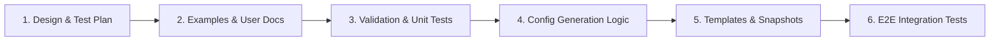

# Plan: Expand VirtualServer & VirtualServerRoute Match Routing to Support `$jwt_` Variables (#11175)

## Status: Draft

## Summary

**Goal:** Expand `VirtualServer` (VS) and `VirtualServerRoute` (VSR) conditional routing (`matches[].conditions[].variable`) and NGINX Plus variable lists in NGINX Ingress Controller (NIC) to support NGINX Plus `ngx_http_auth_jwt_module` embedded variables (`$jwt_claim_<name>`, `$jwt_header_<name>`, and `$jwt_payload`), enabling claims-based and header-based request routing across both server-level and route/subroute-level `JWTAuth` policies.

**References:**
- Issue: [#11175](https://github.com/nginx/kubernetes-ingress/issues/11175) (parent: [#6829](https://github.com/nginx/kubernetes-ingress/issues/6829), sibling: [#11174](https://github.com/nginx/kubernetes-ingress/issues/11174))
- NIC Documentation: [VirtualServer and VirtualServerRoute Resources — Condition](https://docs.nginx.com/nginx-ingress-controller/configuration/virtualserver-and-virtualserverroute-resources/#condition)
- NGINX Plus Documentation: [`ngx_http_auth_jwt_module` Embedded Variables](https://nginx.org/en/docs/http/ngx_http_auth_jwt_module.html#variables)

---

## API Design

No new CRD struct fields are required on `Condition` (`pkg/apis/configuration/v1/types.go`). Instead, expand the allowed NGINX variables in `routes[].matches[].conditions[].variable` (for `VirtualServer`) and `subroutes[].matches[].conditions[].variable` (for `VirtualServerRoute`) when running with **NGINX Plus** (`isPlus == true`), and add `$jwt_payload` to NGINX Plus special variables where `$jwt_claim_<name>` and `$jwt_header_<name>` are already accepted:

```yaml
apiVersion: k8s.nginx.org/v1
kind: VirtualServer
metadata:
  name: cafe
spec:
  host: cafe.example.com
  upstreams:
    - name: admin-backend
      service: admin-svc
      port: 80
    - name: regular-backend
      service: regular-svc
      port: 80
  routes:
    - path: /coffee
      policies:
        - name: jwt-policy
      matches:
        - conditions:
            - variable: $jwt_claim_role
              value: admin
            - variable: $jwt_header_alg
              value: RS256
          action:
            proxy:
              upstream: admin-backend
              requestHeaders:
                set:
                  - name: X-JWT-Sub
                    value: ${jwt_claim_sub}
                  - name: X-JWT-Payload
                    value: ${jwt_payload}
      action:
        pass: regular-backend
```

### Supported `$jwt_` Variables Specification

| Variable Pattern | Contexts Supported | NGINX Plus Only | Validation / Constraints | Description |
|---|---|---|---|---|
| `$jwt_claim_<name>` | • `matches[].conditions[].variable`<br>• `action.proxy.requestHeaders.set[].value` (`${jwt_claim_<name>}`) | Yes | `<name>` must be non-empty and consist of alphanumeric characters or `_` (`isValidSpecialHeaderLikeVariable`) | Evaluates to the value of the specified top-level JWT claim. |
| `$jwt_header_<name>` | • `matches[].conditions[].variable`<br>• `action.proxy.requestHeaders.set[].value` (`${jwt_header_<name>}`) | Yes | `<name>` must be non-empty and consist of alphanumeric characters or `_` (`isValidSpecialHeaderLikeVariable`) | Evaluates to the value of the specified JOSE header parameter (e.g., `alg`, `kid`, `typ`). |
| `$jwt_payload` | • `matches[].conditions[].variable`<br>• `action.proxy.requestHeaders.set[].value` (`${jwt_payload}`) | Yes | Exact variable name `jwt_payload` (no suffix allowed) | Evaluates to the decrypted top-level payload of a JWS or JWE token. |

---

## NGINX Plus Configuration Design

Using NGINX Plus `ngx_http_auth_jwt_module` and `ngx_http_map_module`:

1. **Condition & Match Map Generation (`http` context)**:
   - `generateMatchesConfig` (`internal/configs/virtualserver.go`) passes `condition.Variable` via `getNameForSourceForMatchesRouteMapFromCondition` directly as the `map` source variable:
     ```nginx
     map $jwt_claim_role $vs_default_cafe_matches_0_match_0_cond_0 {
         "admin" 1;
         default 0;
     }

     map $jwt_header_alg $vs_default_cafe_matches_0_match_0_cond_1 {
         "RS256" 1;
         default 0;
     }

     map $vs_default_cafe_matches_0_match_0_cond_0$vs_default_cafe_matches_0_match_0_cond_1 $vs_default_cafe_matches_0 {
         ~^11$ /internal_location_matches_0_match_0;
         default /internal_location_matches_0_default;
     }
     ```
2. **Entry Redirect Location & Route-Level `JWTAuth` Evaluation (`server` context)**:
   - For a route or subroute with `matches`, NIC generates an `InternalRedirectLocation` (`location /coffee { rewrite ^ $vs_default_cafe_matches_0 last; }`).
   - Because `rewrite` executes in `NGX_HTTP_REWRITE_PHASE` (before redirecting to `/internal_location_matches_...`), NGINX evaluates `$vs_default_cafe_matches_0`—and therefore `$jwt_claim_*`, `$jwt_header_*`, and `$jwt_payload`—while the request is still in `location /coffee`.
   - In `ngx_http_auth_jwt_module`, the variable getters for `$jwt_*` inspect the current location's `auth_jwt` configuration to locate and decode the token.
   - When `JWTAuth` is attached at the **server level** (`spec.policies`), `location /coffee` inherits `auth_jwt` from `server`.
   - When `JWTAuth` is attached at the **route or subroute level** (`routes[].policies` or `subroutes[].policies`), `InternalRedirectLocation` must also render the route's `JWTAuth` directives (`auth_jwt`, `auth_jwt_key_file`, `auth_jwt_key_cache`, `auth_jwt_key_request`) so `$jwt_*` variables are populated during `rewrite` before jumping to the internal match location:
     ```nginx
     location /coffee {
         auth_jwt "Cafe App" token=$http_token;
         auth_jwt_key_file /etc/nginx/secrets/default-jwt-secret;
         client_max_body_size 0;
         rewrite ^ $vs_default_cafe_matches_0 last;
     }
     ```
3. **Internal Match Target Locations (`server` context)**:
   - Each internal location (`location ~ ^/internal_location_matches_0_match_0$`) continues to receive `routePoliciesCfg` via `addPoliciesCfgToLocations`, enforcing `auth_jwt` signature/expiration verification in `NGX_HTTP_ACCESS_PHASE` and proxying to the matched upstream.

---

## Implementation Phases

### Phase 1: Examples & User Contract

1. **Create / Update Example Manifests**:
   - Update `examples/custom-resources/jwt/` (or add a dedicated routing example) and `docs/content/configuration/virtualserver-and-virtualserverroute-resources.md` to document `$jwt_claim_<name>`, `$jwt_header_<name>`, and `$jwt_payload` (NGINX Plus only) in `condition.variable` and `action.proxy.requestHeaders`.

### Phase 2: Validation & CRD Documentation

1. **Update `pkg/apis/configuration/validation/common.go`**:
   - Extend `parseSpecialVariable` and `validateSpecialVariable` to support `jwt_payload` as an exact NGINX Plus special variable (returning `field.Forbidden(fieldPath, "is only supported in NGINX Plus")` when `!isPlus`, and rejecting any trailing suffix such as `jwt_payload_foo`).
2. **Update `pkg/apis/configuration/validation/virtualserver.go` & `virtualserver_test.go`**:
   - Add `"jwt_payload"` to `actionProxyHeaderSpecialVariables` (`[]string{"arg_", "http_", "cookie_", "jwt_claim_", "jwt_header_", "jwt_payload"}`).
   - Define `conditionSpecialVariableNames = []string{"jwt_claim_", "jwt_header_", "jwt_payload"}`.
   - Thread `vsv.isPlus` through `validateMatch` -> `validateCondition` -> `validateVariableName`.
   - In `validateVariableName`, strip the leading `$` and delegate to `validateSpecialVariable(nVar, fieldPath, isPlus)` when `nVar` matches a prefix in `conditionSpecialVariableNames`; otherwise validate against `validVariableNames`.
   - Add positive and negative table-driven unit tests in `pkg/apis/configuration/validation/virtualserver_test.go` covering:
     - Valid `$jwt_claim_<name>`, `$jwt_header_<name>`, and `$jwt_payload` in `matches[].conditions[].variable` and `action.proxy.requestHeaders` when `isPlus: true`.
     - Rejection with `Forbidden` when `isPlus: false` (NGINX OSS).
     - Rejection of malformed names (`$jwt_claim_`, `$jwt_header_`, `$jwt_claim_foo-bar`, `$jwt_claim_foo.bar`, `$jwt_payload_extra`, and dangerous characters).
3. **Update CRD Documentation**:
   - Update `pkg/apis/configuration/v1/types.go` comments on `Condition.Variable` if applicable and run `make update-crds` to refresh `docs/crd/k8s.nginx.org_virtualservers.md` and `docs/crd/k8s.nginx.org_virtualserverroutes.md`.

### Phase 3: NGINX Plus Configuration Generation

1. **Update Template Structs in `internal/configs/version2/http.go`**:
   - Add `JWTAuth *JWTAuth` to `InternalRedirectLocation`.
2. **Wire Route-Level `JWTAuth` to `InternalRedirectLocation` in `internal/configs/virtualserver.go`**:
   - In `generateRouteConfig` (when `len(r.Matches) > 0` or `len(r.Splits) > 0`) and `generateSubRoutesConfig` (when `len(r.Matches) > 0` or `len(r.Splits) > 0`), set `cfg.InternalRedirectLocation.JWTAuth = routePoliciesCfg.JWTAuth`.
   - Add unit tests in `internal/configs/virtualserver_test.go` verifying both map source generation for `$jwt_*` condition variables and `InternalRedirectLocation.JWTAuth` population for route-level and subroute-level `JWTAuth` policies.

### Phase 4: Template Rendering & Snapshots

1. **Update `internal/configs/version2/nginx-plus.virtualserver.tmpl`**:
   - Inside `{{- range $l := $s.InternalRedirectLocations }}`, render the `{{- with $l.JWTAuth }}` block (`auth_jwt`, `auth_jwt_key_file`, `auth_jwt_key_cache`, `auth_jwt_key_request`) before `rewrite ^ {{ $l.Destination }} last;`.
   - Keep `internal/configs/version2/nginx.virtualserver.tmpl` (OSS) unchanged so Plus-only `auth_jwt` directives never appear in OSS templates.
2. **Update Snapshot Tests**:
   - Add/update test fixtures in `internal/configs/version2/http_test.go` and `internal/configs/virtualserver_test.go` exercising `$jwt_claim_*`, `$jwt_header_*`, and `$jwt_payload` match conditions with route-level `JWTAuth`.
   - Run `make test-update-snaps` and `make test` to verify non-empty golden snapshot diffs in `__snapshots__/`.

### Phase 5: End-to-End Integration Tests

1. **Python Integration Tests**:
   - Extend `tests/suite/test_jwt_policies.py` and `tests/suite/test_jwt_policies_vsr.py` (with test manifests in `tests/data/jwt-policy/`) to test conditional routing on `$jwt_claim_<name>`, `$jwt_header_<name>`, and `$jwt_payload` across both spec-level (`spec.policies`) and route/subroute-level (`routes[].policies` / `subroutes[].policies`) `JWTAuth` policies.

---

## PR / Commit Stack Structure

To keep reviews focused and incremental, the change can be structured as a 6-part commit / PR stack:



| Order | Scope | Purpose for Reviewers | Files Included |
| :---: | --- | --- | --- |
| **1** | **Design & Test Plan** | Align on supported `$jwt_` variables (`$jwt_claim_<name>`, `$jwt_header_<name>`, `$jwt_payload`), NGINX Plus gating, route-level `InternalRedirectLocation` `auth_jwt` evaluation during `rewrite`, and test strategy. | • [`docs/developer/jwt-variable-match-plan.md`](jwt-variable-match-plan.md) |
| **2** | **Examples & User Docs** | Demonstrate claims-based and header-based match routing in `VirtualServer` / `VirtualServerRoute` examples and user documentation. | • [`examples/custom-resources/jwt/virtual-server.yaml`](../../examples/custom-resources/jwt/virtual-server.yaml)<br>• [`examples/custom-resources/jwt/README.md`](../../examples/custom-resources/jwt/README.md)<br>• [`docs/content/configuration/virtualserver-and-virtualserverroute-resources.md`](../content/configuration/virtualserver-and-virtualserverroute-resources.md) |
| **3** | **Validation & Unit Tests** | Review `isPlus`-aware validation for `$jwt_claim_<name>`, `$jwt_header_<name>`, and `$jwt_payload` in `matches[].conditions[].variable` and `action.proxy.requestHeaders`, plus positive/negative unit tests. | • [`pkg/apis/configuration/validation/common.go`](../../pkg/apis/configuration/validation/common.go)<br>• [`pkg/apis/configuration/validation/virtualserver.go`](../../pkg/apis/configuration/validation/virtualserver.go)<br>• [`pkg/apis/configuration/validation/virtualserver_test.go`](../../pkg/apis/configuration/validation/virtualserver_test.go) |
| **4** | **Config Generation Logic** | Review `InternalRedirectLocation.JWTAuth` struct addition, route/subroute-level `JWTAuth` propagation for `matches`/`splits` routes, and config generation unit tests. | • [`internal/configs/version2/http.go`](../../internal/configs/version2/http.go)<br>• [`internal/configs/virtualserver.go`](../../internal/configs/virtualserver.go)<br>• [`internal/configs/virtualserver_test.go`](../../internal/configs/virtualserver_test.go) |
| **5** | **Template Rendering & Snapshots** | Review NGINX Plus `InternalRedirectLocations` `auth_jwt` template rendering and golden snapshot updates. | • [`internal/configs/version2/nginx-plus.virtualserver.tmpl`](../../internal/configs/version2/nginx-plus.virtualserver.tmpl)<br>• [`internal/configs/version2/http_test.go`](../../internal/configs/version2/http_test.go)<br>• [`internal/configs/version2/__snapshots__/http_test.snap`](../../internal/configs/version2/__snapshots__/http_test.snap)<br>• [`internal/configs/__snapshots__/virtualserver_test.snap`](../../internal/configs/__snapshots__/virtualserver_test.snap) |
| **6** | **End-to-End Tests** | Verify full runtime behavior in pytest for VS and VSR `matches` routing using `$jwt_claim_*`, `$jwt_header_*`, and `$jwt_payload` with both server-level and route/subroute-level `JWTAuth` policies. | • [`tests/suite/test_jwt_policies.py`](../../tests/suite/test_jwt_policies.py)<br>• [`tests/suite/test_jwt_policies_vsr.py`](../../tests/suite/test_jwt_policies_vsr.py)<br>• [`tests/data/jwt-policy/`](../../tests/data/jwt-policy/) |
