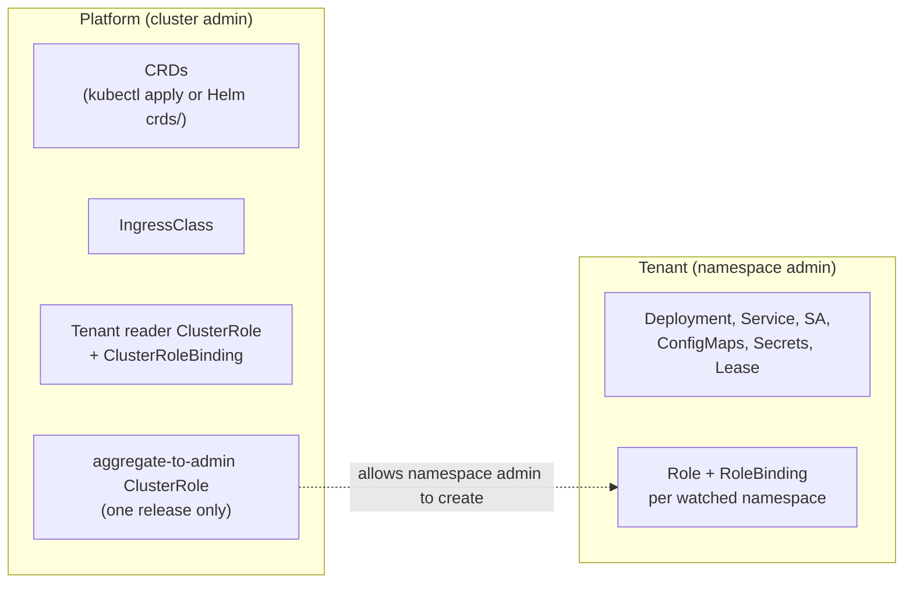
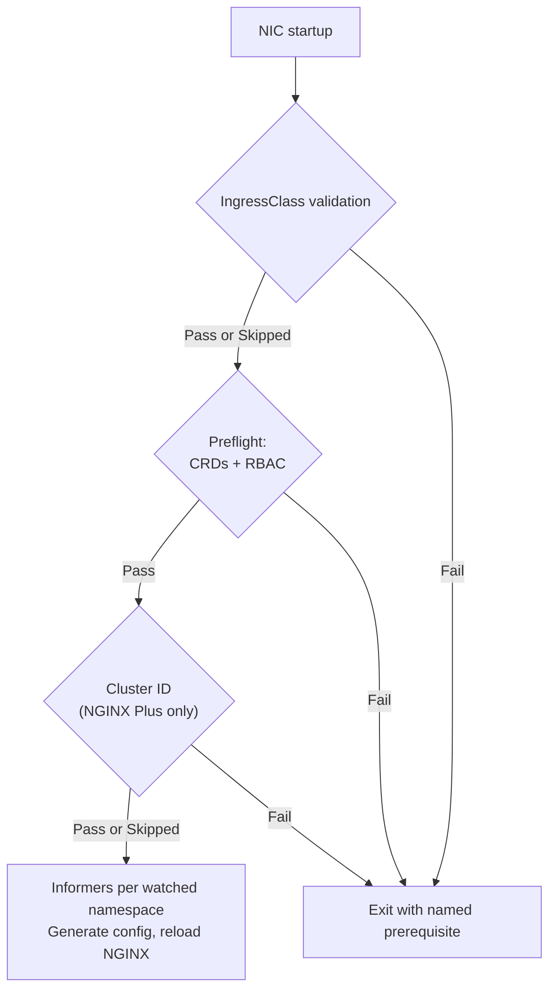

# High-Level Design: Namespace-Scoped Installation

> Status: Proposal
>
> Milestone: 5.8.0

## Overview

NGINX Ingress Controller (NIC) assumes it is installed by someone with
cluster-admin rights. The Helm chart renders a ClusterRoleBinding by default,
renders an IngressClass by default, and installs CRDs. The controller reads its
IngressClass at startup and exits if it can't. Some optional features read
Nodes and the `kube-system` Namespace. In a multi-tenant cluster, an
application team that only administers its own namespace therefore can't
install or run NIC.

This design splits installation into two phases:

1. **Platform phase.** A cluster admin installs the cluster-scoped
   prerequisites: CRDs, the tenant's IngressClass, and a small read-only
   ClusterRole for the tenant.
2. **Tenant phase.** A namespace admin installs and runs NIC using only
   namespaced resources and namespaced RBAC.

A new chart value, `installMode`, selects which phase a release renders. Two
new controller flags let NIC start without access to the IngressClass, and
decide what happens when the cluster ID can't be read. A startup check reports
missing CRDs and missing permissions by name, instead of logging informer errors
forever.

The community ingress-nginx project covers part of this with `--watch-namespace`
and `scope.enabled`. This design goes further: it separates the install phases
explicitly and gives clear errors when a prerequisite is missing.

## Goals

- Let a namespace admin install, upgrade, and remove NIC without any
  cluster-scoped write permissions.
- Render cluster-scoped prerequisites only from a separate platform release,
  one release per tenant.
- Keep all features working in tenant mode, including telemetry, topology-aware
  routing, NGINX Plus license reporting, and NGINX Agent v3, as long as the
  platform grants the tenant reader ClusterRole. See
  [RBAC Model](#rbac-model).
- Let NIC start without reading its IngressClass (#10783). See
  [CLI Flags](#cli-flags).
- Name the missing CRD, permission, or IngressClass in the error, and exit at
  startup instead of failing silently in tenant mode (see
  [Open Decisions](#open-decisions) for `full` mode). See
  [Startup Checks](#startup-checks).
- Keep the default install (`installMode: full`) and default flag behaviour
  unchanged.

## Non-Goals

- Making IngressClass, CRDs, ClusterRoles, or webhooks namespace-scoped, or
  letting tenants create them.
- Installing CRDs from a tenant release, or managing CRDs through chart values.
  CRDs stay in Helm's `crds/` directory.
- Label-based namespace watching (`-watch-namespace-label`) in tenant mode. It
  needs a cluster-wide Namespace watch.
- Isolating tenants from each other on shared nodes, beyond what RBAC and watch
  scope provide. For example, NIC pods and host ports are not isolated.
- One platform release that takes a list of tenants.
- Changing how NIC selects resources by ingress class (`HasCorrectIngressClass`).

## Background: How Kubernetes Scopes an Ingress Controller

The design relies on the following Kubernetes and Helm behaviour.

- **Cluster-scoped kinds.** IngressClass, ClusterRole, ClusterRoleBinding,
  CustomResourceDefinition, Namespace, Node, and the webhook configurations have
  no namespace. Creating, reading, or listing them needs a ClusterRoleBinding.
  A RoleBinding only grants access inside its own namespace.
- **RBAC escalation prevention.** A user can create a Role only if they already
  hold every permission in it, or hold the `escalate` verb. The built-in `admin`
  ClusterRole, which namespace admins usually hold through a RoleBinding, gives
  no rights on NIC's CRDs. The platform must add those rights before a tenant
  can create NIC's Role. ClusterRoles labelled
  `rbac.authorization.k8s.io/aggregate-to-admin: "true"` are merged into
  `admin` automatically.
- **A namespace's own object.** The API server treats
  `GET /api/v1/namespaces/<name>` as a request in namespace `<name>`. A Role in
  that namespace can therefore grant `get` on that one Namespace object. It
  can't grant `list` or `watch` on Namespaces.
- **`resourceNames`.** Rules can be limited to named objects for `get`,
  `update`, and `delete`. They can't be limited for `create`, or for a `list`
  without a field selector, so `nodes list` always returns every Node.
- **Helm `crds/`.** Helm installs files in `crds/` before rendering templates,
  never upgrades or deletes them, and ignores only "already exists" errors.
  The API server checks permissions before existence, so a tenant without CRD
  rights gets "forbidden" even when the CRDs are installed, and the install
  fails. Tenants must pass `--skip-crds`.
- **Release storage.** Helm stores release state in Secrets in the release
  namespace. Tenants can usually delete Secrets in their own namespace, so a
  platform release must not live there.
- **Permission checks.** Every authenticated identity can ask the API server
  whether it may perform a given action (a SelfSubjectAccessReview). The
  built-in `system:basic-user` ClusterRole allows this.

### What NIC Reads Today

| Read | Code | Scope | When denied today |
| --- | --- | --- | --- |
| IngressClass `get` | `mustValidateIngressClass()` in `cmd/nginx-ingress/main.go` | Cluster | **Exit** |
| Namespace `get` or `list` | `checkNamespaces()` in `cmd/nginx-ingress/main.go` | Cluster (`get` on itself is namespaced) | Warning |
| Namespace `kube-system` `get` | `GetClusterID()` in `internal/common_cluster_info` | Cluster | Agent v3: **exit** (via `CollectAndWrite()` in `internal/nginx/manager.go`); license report: empty `cluster_id`; telemetry: empty field |
| Nodes `list` | `GetNodeCount`, `getControllerZone`, telemetry `Platform` | Cluster | License: count 0; zone routing off; telemetry: empty fields |
| IngressClasses `list` | telemetry `IngressClassCount` | Cluster | Debug log, count 0 |
| Namespace `list/watch` by label | `addNamespaceHandler()` in `internal/k8s/namespace.go` | Cluster | Informer errors forever |
| Ingress, Service, EndpointSlice, Pod, Secret, NIC CRDs, AppProtect, cert-manager, ExternalDNS | `newNamespacedInformer()` in `internal/k8s/controller.go` | Namespaced per watched namespace | Informer errors forever, NIC never becomes ready |
| ConfigMaps, Leases, Pods, headless Service, IngressLink, GlobalConfiguration | controller setup | Release namespace, or the configured namespace | Varies |

## User Contract

### Install Modes

| `installMode` | Who installs it | Release namespace | Renders |
| --- | --- | --- | --- |
| `full` (default) | Cluster admin | Any | Today's output, unchanged |
| `platform` | Cluster admin, once per tenant | A platform namespace, never the tenant's | Cluster-scoped prerequisites for one tenant |
| `tenant` | Namespace admin | The tenant namespace | Namespaced resources only |

### Helm Values

| Value | Type | Default | Mode | Effect |
| --- | --- | --- | --- | --- |
| `installMode` | `full`, `platform`, or `tenant` | `full` | All | Selects which resources are rendered |
| `platform.tenantNamespace` | string | — | `platform`, required | Namespace of the tenant ServiceAccount the reader ClusterRole is bound to |
| `platform.tenantReader.create` | boolean | `true` | `platform` | Renders the tenant reader ClusterRole and its binding |
| `platform.aggregateToAdmin.create` | boolean | `false` | `platform` | Renders the ClusterRole that grants namespace admins NIC's tenant permissions. Enable it in exactly one release. |
| `controller.serviceAccount.name` | string | Chart full name | `platform` and `tenant`, required | Must match between the tenant release and its platform release |
| `controller.watchNamespace` | string | Release namespace in `tenant` mode | All | One Role and RoleBinding per listed namespace in `tenant` mode |
| `controller.ingressClass.validation` | `strict` or `skip` | `strict` | `full` and `tenant` | Sets `-ingress-class-validation` |
| `controller.mgmt.clusterIDRequired` | boolean | `true` | `full` and `tenant`, NGINX Plus | Sets `-license-cluster-id-required` |

Chart validation (`fail` in `_helpers.tpl`) rejects these combinations:

- `tenant` with `watchNamespaceLabel` set
- `platform` or `tenant` without `controller.serviceAccount.name`
- `platform` without `platform.tenantNamespace`
- `platform` with `platform.tenantNamespace` equal to the release namespace
- `tenant` with a `globalConfiguration.customName` namespace that isn't watched

### CLI Flags

| Flag | Values | Default | Behaviour |
| --- | --- | --- | --- |
| `-ingress-class-validation` | `strict`, `skip` | `strict` | `strict`: today's check; NIC exits if the IngressClass can't be read, doesn't exist, or has the wrong `spec.controller`. `skip`: no API call; NIC logs one warning and starts. |
| `-license-cluster-id-required` | boolean | `true` | NGINX Plus only. When the `kube-system` read is **forbidden**: with `true`, NIC exits and names the missing rule; with `false`, it logs one warning and reports an empty `cluster_id`. Other errors are retried, as today. |

Resource selection is unchanged in `skip` mode. `HasCorrectIngressClass()`
in `internal/k8s/controller.go` only compares names, from the
`kubernetes.io/ingress.class` annotation or `spec.ingressClassName`. It never
reads the IngressClass object. The only thing lost in `skip` mode is detecting a
mistyped class name or a class owned by another controller.

### Resource Ownership

| Resource | Scope | Owner | Rendered by |
| --- | --- | --- | --- |
| CRDs | Cluster | Platform | `kubectl apply -f deploy/crds.yaml`, or Helm `crds/` from any non-tenant release |
| IngressClass | Cluster | Platform | `platform`, `full` |
| Tenant reader ClusterRole and ClusterRoleBinding | Cluster | Platform | `platform` |
| Aggregate-to-admin ClusterRole | Cluster | Platform | `platform` with `aggregateToAdmin.create` |
| Controller ClusterRole and ClusterRoleBinding | Cluster | Platform | `full` only |
| Deployment, DaemonSet, or StatefulSet; Service; HPA; PDB; NetworkPolicy; ServiceMonitor | Namespaced | Tenant | `tenant`, `full` |
| ServiceAccount | Namespaced | Tenant | `tenant`, `full` |
| Role and RoleBinding, one per watched namespace | Namespaced | Tenant | `tenant`; `full` renders only today's single Role |
| ConfigMaps, Secrets, Lease, GlobalConfiguration | Namespaced | Tenant | `tenant`, `full` |
| VirtualServer, VirtualServerRoute, TransportServer, Policy, Ingress | Namespaced | Tenant | Not by the chart |

#### Examples

```yaml
# Platform release for team-a, installed by a cluster admin into nic-platform.
# helm install nic-team-a-platform oci://ghcr.io/nginx/charts/nginx-ingress \
#   -n nic-platform -f platform-team-a.yaml
installMode: platform
platform:
  tenantNamespace: team-a
  aggregateToAdmin:
    create: true # only in the first platform release
controller:
  serviceAccount:
    name: nic
  ingressClass:
    name: team-a
---
# Tenant release, installed by the team-a namespace admin.
# helm install nic oci://ghcr.io/nginx/charts/nginx-ingress \
#   -n team-a --skip-crds -f tenant-team-a.yaml
installMode: tenant
controller:
  serviceAccount:
    name: nic
  ingressClass:
    name: team-a
  watchNamespace: team-a,team-a-apps
```

```yaml
# Tenant without any platform grant: NIC still starts, and features
# that need cluster reads degrade with warnings.
installMode: tenant
controller:
  serviceAccount:
    name: nic
  ingressClass:
    name: team-b
    validation: skip
```

## Architecture

### Install Phases

Each platform release serves one tenant, and tenants install with
`--skip-crds`. See [Install Modes](#install-modes) and
[Resource Ownership](#resource-ownership).



### Startup Flow

"Skipped" means `-ingress-class-validation=skip`, an NGINX OSS build, or
`-license-cluster-id-required=false`. See [Startup Checks](#startup-checks)
for the condition and error message behind each "Fail".



The controller's informer layer already supports namespace scoping:
`newNamespacedInformer` creates every factory with `WithNamespace(ns)` for each
namespace in `-watch-namespace`. This design adds no new informers. It changes
the following:

1. **Startup** (`cmd/nginx-ingress/main.go`). Validate the IngressClass
   according to the flag. Treat "forbidden" errors on cluster reads as a known
   condition instead of an unexpected error. Add a preflight check before the
   controller starts.
2. **Cluster info** (`internal/common_cluster_info`, `internal/license_reporting`,
   `internal/metadata`, `internal/nginx/manager.go`). Apply
   `-license-cluster-id-required` in one place, and stop Agent v3 exiting when
   the opt-out is set.
3. **Telemetry** (`internal/telemetry/cluster.go`). Log a forbidden read once,
   at info level, instead of at debug level on every run.
4. **Chart.** Add `installMode`. Keep one shared list of RBAC rules in
   `_helpers.tpl`, used by the controller ClusterRole, the tenant Role, and the
   aggregate-to-admin ClusterRole, so the three can't drift apart.

### RBAC Model

**Tenant Role**, rendered once per watched namespace. The rules come from the
same conditions as `clusterrole.yaml`, limited to namespaced resources:

| API group | Resources | Verbs | Where |
| --- | --- | --- | --- |
| `""` | `namespaces` (its own object) | `get` | Every watched namespace |
| `""` | `services`, `pods`, `configmaps`, `secrets` | `get`, `list`, `watch` | Every watched namespace (`secrets` follows `watchSecretNamespace`) |
| `""` | `events` | `create`, `patch`, `list` | Every watched namespace |
| `discovery.k8s.io` | `endpointslices` | `get`, `list`, `watch` | Every watched namespace |
| `networking.k8s.io` | `ingresses`, `ingresses/status` | `get`, `list`, `watch`; `update` on status | Every watched namespace |
| `k8s.nginx.org` | VS, VSR, TS, Policy, GlobalConfiguration, and their status subresources | Read; `update` on status | Every watched namespace, if custom resources are enabled |
| `appprotect.f5.com`, `appprotectdos.f5.com`, `cert-manager.io`, `externaldns.nginx.org`, `cis.f5.com` | As in `clusterrole.yaml` | As in `clusterrole.yaml` | Every watched namespace, if the feature is enabled |
| `""` | `services` | `create`, `update`, `patch`, `delete` | Release namespace (headless Service for zone sync, external Service status) |
| `""` | `pods` | `update` | Release namespace |
| `apps` | `replicasets`, `daemonsets`, `statefulsets` | `get` | Release namespace (installation ID and name) |
| `coordination.k8s.io` | `leases` | `get`, `update` on the lock; `create` | Release namespace |

A namespace that is only in `watchSecretNamespace` gets only the `namespaces`,
`secrets`, and `events` rules.

**Tenant reader ClusterRole**, bound to `<tenantNamespace>/<serviceAccount.name>`:

| API group | Resources | Verbs | Used by |
| --- | --- | --- | --- |
| `networking.k8s.io` | `ingressclasses` | `get`, `list` | `strict` validation, telemetry |
| `""` | `namespaces`, `resourceNames: [kube-system]` | `get` | Cluster ID for license reporting, Agent v3, telemetry |
| `""` | `nodes` | `list` | Topology-aware routing, license node count, telemetry |

It grants no write access. `nodes list` exposes every Node object to the
tenant, which was accepted (decision D5). `ingressclasses list` exposes only
class names and controller names.

**Aggregate-to-admin ClusterRole.** It contains the same rules as the tenant
Role, labelled `aggregate-to-admin: "true"`. Namespace admins then hold every
permission in the tenant Role, so they can create it without the `escalate`
verb. It applies to every namespace admin in the cluster, which is why it has
its own toggle.

### Startup Checks

NIC runs these checks in order before creating the controller:

| Check | Condition | Result |
| --- | --- | --- |
| IngressClass | `strict` and the read fails, the class is missing, or it has the wrong controller | Exit: `IngressClass "team-a": forbidden; grant get on ingressclasses or set -ingress-class-validation=skip` |
| Watched namespaces | `get` is forbidden | Info log: `cannot verify namespace X exists`, then continue |
| CRDs | A required API resource is missing from discovery (`k8s.nginx.org/v1`, and AppProtect, ExternalDNS, or cert-manager groups when enabled) | Exit: `CRD virtualservers.k8s.nginx.org is not installed; the platform admin must apply deploy/crds.yaml` |
| RBAC | A SelfSubjectAccessReview is denied for any (namespace, resource, verb) that NIC uses | Exit: `missing permission: list endpointslices.discovery.k8s.io in namespace team-a-apps` |
| Cluster ID (NGINX Plus) | The `kube-system` read is forbidden and `-license-cluster-id-required=true` | Exit: `cannot read namespace kube-system for license reporting; grant get on it or set -license-cluster-id-required=false` |

Only "forbidden" or "not found" results cause an exit. Timeouts and other API
errors are retried with backoff, so NIC doesn't crash-loop while the control
plane is upgraded.

### Chart Rendering Rules

- `installMode: full` renders exactly what the chart renders today, byte for
  byte. That includes the existing ClusterRoleBinding, which is rendered even
  when `rbac.clusterrole.create=false`.
- `installMode: tenant` never renders a cluster-scoped kind. A chart test
  parses the output and checks every `kind`.
- `installMode: platform` renders only cluster-scoped kinds, plus nothing in the
  release namespace other than Helm's own release Secret.
- `rbac.create=false` turns off the ServiceAccount, Roles, and RoleBindings in
  tenant mode, and the reader binding in platform mode, for teams that manage
  their own RBAC.
- `NOTES.txt` prints the next step for each mode. For example, in tenant mode it
  reminds the user to pass `--skip-crds` and lists the platform prerequisites
  together with the ServiceAccount name.

### Rendered Examples

Output kinds for the examples above:

```text
# installMode: platform, tenantNamespace: team-a
# (release: nic-team-a-platform, fullname: nic-team-a-platform-nginx-ingress)
IngressClass        team-a
ClusterRole         nic-team-a-platform-nginx-ingress-tenant-reader
ClusterRoleBinding  nic-team-a-platform-nginx-ingress-tenant-reader  -> team-a/nic
ClusterRole         nginx-ingress-tenant-aggregate-to-admin

# installMode: tenant, watchNamespace: team-a,team-a-apps
# (release: nic, fullname: nic-nginx-ingress)
ServiceAccount      team-a/nic
Role                team-a/nic-nginx-ingress
RoleBinding         team-a/nic-nginx-ingress
Role                team-a-apps/nic-nginx-ingress
RoleBinding         team-a-apps/nic-nginx-ingress
ConfigMap           team-a/nic-nginx-ingress
Lease               team-a/nic-nginx-ingress-leader-election
Deployment          team-a/nic-nginx-ingress-controller
Service             team-a/nic-nginx-ingress-controller
```

The aggregate-to-admin ClusterRole uses the fixed name
`nginx-ingress-tenant-aggregate-to-admin`, independent of the release name, so
that exactly one platform release can own it. All other resource names follow
the chart's `nginx-ingress.fullname` convention.

Controller arguments in tenant mode:

```text
-ingress-class=team-a
-watch-namespace=team-a,team-a-apps
-nginx-configmaps=$(POD_NAMESPACE)/nic-nginx-ingress
```

`-ingress-class-validation` and `-license-cluster-id-required` are rendered only
when they differ from their defaults, so existing snapshots don't change.

## Comparison with the Full Install

| | `full` | `platform` + `tenant` |
| --- | --- | --- |
| Installer rights | Cluster admin | Platform: cluster admin, once per tenant. Tenant: namespace admin. |
| Watch scope | All namespaces by default | Listed namespaces only |
| Label-based namespace watch | Supported | Not supported |
| Controller RBAC | One ClusterRole | One Role per watched namespace, plus a read-only ClusterRole |
| CRD lifecycle | Helm `crds/` | Platform-owned; tenant uses `--skip-crds` |
| Several controllers in one cluster | Possible, with manual RBAC | Supported pattern |
| Feature parity | Full | Full with the reader ClusterRole; degraded without it |

## Interactions with Other Features

| Feature | Interaction | Guidance |
| --- | --- | --- |
| VirtualServer, VSR, TS, and Policy without `ingressClassName` | Every NIC that watches the namespace accepts them | Give each tenant its own namespaces, or set `ingressClassName` explicitly |
| Cross-namespace references (VSR, Policy, Secret, `namespace/name`) | Visible only if the referenced namespace is watched and has a tenant Role | Add the namespace to `watchNamespace`, or `watchSecretNamespace` for Secrets |
| `-watch-namespace-label` | Needs cluster-wide Namespace watch | Rejected in tenant mode |
| GlobalConfiguration | Read from its namespace | Must be in a watched namespace in tenant mode |
| cert-manager and ExternalDNS | Already namespace-scoped per watched namespace | Their CRDs are platform prerequisites |
| AppProtect WAF and DoS | Dynamic informers, namespace-scoped | CRDs from `deploy/crds-nap-*.yaml` are platform prerequisites |
| Leader election | Lease in the release namespace | Unchanged |
| Telemetry | Reads Nodes, `kube-system`, IngressClasses | Works with the reader ClusterRole; empty fields without it |
| NGINX Plus license reporting | Reads `kube-system` and Nodes | See `-license-cluster-id-required` |
| NGINX Agent v3 | Reads `kube-system` for its labels | Today it exits if denied. With the opt-out, the `cluster-id` label is empty. |
| Topology-aware routing | Reads Nodes | Works with the reader ClusterRole; turned off with a warning without it |

## Security Model

- **No new privileges in `full` mode.** The default output is unchanged.
- **The tenant gets less, not more.** In tenant mode, the controller loses its
  cluster-wide Secret, Service, and Ingress access. It gains only the read-only
  reader ClusterRole.
- **Reader exposure.** `nodes list` reveals node names, labels, addresses, and
  capacity. `ingressclasses list` reveals class names. `kube-system` `get`
  reveals the namespace's UID and labels. Platforms that don't accept this can
  set `platform.tenantReader.create=false`, and tenants then use the
  degraded-mode flags.
- **Aggregation.** `aggregateToAdmin` gives every namespace admin rights on NIC's
  CRDs in their own namespaces. The toggle is off by default. Platforms with a
  custom tenant role can bind the rules to that role instead.
- **The platform release stays out of reach.** It must not live in the tenant
  namespace, and the chart enforces this, so a tenant can't delete or tamper
  with the Helm release Secret that owns its prerequisites.
- **IngressClass in `skip` mode.** A tenant can name any class. It still only
  sees resources in its watched namespaces, so `skip` can't be used to take
  over another tenant's traffic, as long as tenants watch separate namespaces.
  If two tenants share a namespace, resources without an explicit
  `ingressClassName` are accepted by both (see
  [Interactions with Other Features](#interactions-with-other-features)).
- **No user input reaches NGINX config.** Neither the flags nor the values
  change generated NGINX configuration.

## Observability

- **Startup logs and exit messages** name the missing prerequisite and the rule
  that fixes it. See [Startup Checks](#startup-checks).
- **Warnings that repeat** today (cluster-ID errors, node count, telemetry) are
  logged once at startup when the cause is "forbidden".
- **Events** on the NIC Pod record a skipped IngressClass validation and a
  missing cluster ID.
- **Telemetry.** No schema change in this milestone. Reporting `installMode` is
  an [open decision](#open-decisions).

## Decisions

| # | Decision | Rationale |
| --- | --- | --- |
| D1 | `-ingress-class-validation=strict\|skip` closes #10783. We own both issues. | The name check never reads the object, so `skip` loses only the safety check |
| D2 | `strict` keeps today's behaviour exactly | No change for existing installs |
| D3 | `installMode: full\|platform\|tenant`, one platform release per tenant | Each tenant's lifecycle is separate, and templates stay simple |
| D4 | `platform.tenantNamespace` is added; the ServiceAccount name is required in both split modes | The platform release lives outside the tenant namespace, and the binding subject must match |
| D5 | The reader ClusterRole includes `nodes list` | Keeps every feature working. Exposing Node objects to tenants is accepted. |
| D6 | `-license-cluster-id-required`, default `true`, with an opt-out | We ship the opt-out now so hardened clusters are not blocked. **Pending sign-off from the licensing owner** on whether an empty `cluster_id` is acceptable for usage reporting. If not, the opt-out is removed before release. The flag uses the `license` spelling, to match `license_reporting` and `licenseTokenSecretName`. |
| D7 | CRDs stay in `crds/`, and tenants use `--skip-crds` | Helm aborts on a forbidden CRD create, and chart values can't skip `crds/` |

## Open Decisions

1. **Preflight in `full` mode.** Should the CRD and RBAC checks exit in every
   mode, turning today's hang into an exit, or exit only in tenant mode and only
   log in `full` mode? The proposal is to exit only in tenant mode.
2. **Licensing sign-off** for D6.
3. **User docs.** The user docs aren't in this repository. They are tracked
   as a separate docs task outside this repo.
4. **Telemetry.** Should `installMode` be reported? That needs
   `make telemetry-schema`.

## Delivery Plan

| Order | Pull request | Contents |
| --- | --- | --- |
| 1 | IngressClass validation (#10783) | `-ingress-class-validation` flag and its validation, an error-returning refactor of the IngressClass check, help text, telemetry IngressClass log, chart value `controller.ingressClass.validation` with schema enum, unit and helm tests, CHANGELOG |
| 2 | Startup behaviour without cluster rights | Forbidden-error helper, `-license-cluster-id-required`, license reporter startup check, Agent v3 fix, namespace-exists log, telemetry logs, chart value `controller.mgmt.clusterIDRequired`, CRD discovery check, permission checks per watched namespace, retry policy, unit tests with fake discovery and permission-check responses |
| 3 | Helm `installMode`, examples, and integration tests | Shared RBAC rule helper, tenant Roles per namespace, platform templates, validation, NOTES, schema, helm snapshot cases (`install-mode-platform`, `install-mode-tenant`, `install-mode-tenant-multi-ns`), negative cases, "no cluster-scoped kinds" test, `examples/shared-examples/multi-tenant/`, static `deployments/rbac/tenant-role.yaml` and `platform-tenant-reader.yaml`, pytest suite with two tenants |

Once pull request 1 merges, #10783 is resolved. Pull request 2 changes only
what happens when access is denied, so it is safe to merge before 3. Until pull
request 3 merges, tenant installs need manual RBAC.

### Requirements Traceability

| Requirement | Addressed by |
| --- | --- |
| #10640: tenant mode renders only namespaced resources | `installMode: tenant`, [Chart Rendering Rules](#chart-rendering-rules), and D7 for CRDs |
| #10640: platform mode renders cluster prerequisites | `installMode: platform` |
| #10640: no IngressClass, ClusterRole, ClusterRoleBinding, CRD, or webhook from the tenant path | Tenant rendering rules; `--skip-crds` (D7); the chart has no webhooks |
| #10640: Role and RoleBinding wherever they can be used | [RBAC Model](#rbac-model) |
| #10640: watch a specific namespace | Existing `-watch-namespace`, plus a tenant Role per namespace |
| #10640: tenant can reference a platform IngressClass | `controller.ingressClass.name` with `strict`, through the reader ClusterRole |
| #10640: clear errors for missing prerequisites | [Startup Checks](#startup-checks) |
| #10640: several independent tenants | One platform release per tenant; [Verification](#verification) |
| #10640: docs (deployment model, platform, tenant, RBAC, IngressClass, Helm, examples, troubleshooting) | Pull request 3 (examples and manifests); user docs tracked separately outside this repo |
| #10783: operate without IngressClass access | `-ingress-class-validation=skip` |

## Verification

- **Unit tests in `cmd/nginx-ingress`**, using a fake clientset that returns
  "forbidden", "not found", and timeout errors:
  - IngressClass `strict`: forbidden -> error, missing -> error, wrong
    controller -> error, valid -> no error
  - IngressClass `skip`: no API calls
  - Cluster ID forbidden with the flag `true` -> error, with `false` -> warning
  - Timeouts are retried
  - Namespace-exists check when forbidden
- **Preflight tests:** a missing CRD in each enabled group; a denied permission
  check for each resource the tenant Role grants; the error names the namespace,
  resource, and verb.
- **Agent v3:** an empty cluster ID with the opt-out set produces labels and
  doesn't exit.
- **Helm unit tests:**
  - `full` output unchanged (existing snapshots don't change)
  - `tenant` with one and with several watched namespaces
  - `platform` with and without `aggregateToAdmin`
  - `tenant` output contains no cluster-scoped kind
  - `platform` output contains only cluster-scoped kinds
  - negative cases for every `fail` rule
  - the tenant Role's rules equal the namespaced subset of the ClusterRole for
    each feature combination
- **Integration tests** in kind, with a namespace-admin identity for the tenant
  installs:
  - Two tenants, each with its own IngressClass, serve only their own
    namespaces.
  - A tenant install with `--skip-crds` succeeds; one without it fails as
    described in D7.
  - With the reader ClusterRole removed and `skip` plus the opt-out set, NIC
    starts and serves traffic.
  - With a CRD removed, NIC exits with the named error.
  - With a tenant Role removed from one namespace, NIC exits and names that
    namespace.
- **Gates:** `make test`, `make lint`, and `make test-update-snaps` with
  snapshot changes only for the new cases.
